# Отчёт по работе № 2

## «Конфигурация и доступ»

**Студент:** Слубик Станислав Олегович

**Группа:** Инженерия данных магистратура 2 курс

**Дата:** 22 Ноября 2026

---

## Задание 1. Деплой без конфигурации

### Шаг 1. Deployment с значениями по умолчанию

В `templates/deployment-v2.yaml` заполнены пропуски: `metadata.name: calc-app`,
`metadata.namespace: demo`, `containerPort: 5000`. Блок `envFrom` на этом шаге
оставлен закомментированным — то есть подам не передаётся ни одной переменной
окружения. `imagePullPolicy: Never` — образ `calc-app:v2` локальный
(загружен в minikube через `minikube image load`), поэтому в registry ходить
нельзя, kubelet должен взять его из локального кэша.

```bash
kubectl apply -f templates/deployment-v2.yaml
kubectl rollout status deployment/calc-app -n demo   # deployment successfully rolled out
```

### Шаг 2. Конфигурация приложения

`kubectl port-forward deployment/calc-app 5000:5000 -n demo &`, затем
`curl http://localhost:5000/config`:

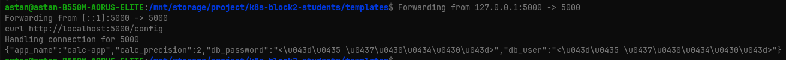

```text
Forwarding from 127.0.0.1:5000 -> 5000
Forwarding from [::1]:5000 -> 5000
Handling connection for 5000
{"app_name":"calc-app","calc_precision":2,"db_password":"\<не задан\>","db_user":"\<не задан\>"}
```

В самом выводе вместо `не задан` — unicode-escape `\u043d\u0435 \u0437\u0430\u0434\u0430\u043d`,
Flask экранирует не-ASCII в JSON.

### Шаг 3. Откуда взялись умолчания

`grep -n "getenv" ../app/app.py`:


```text
15:APP_NAME = os.getenv("APP_NAME", "calc-app")
16:CALC_PRECISION = int(os.getenv("CALC_PRECISION", "2"))
37:        db_user=os.getenv("DB_USER", "<не задан>"),
38:        db_password=os.getenv("DB_PASSWORD", "<не задан>"),
```

**Ответ.** Значения заданы не в образе как `ENV` (поэтому
`docker run --rm calc-app:v2 env` их и не показал бы), а в самом коде
приложения — в `app/app.py`, строки 15–16, вторым аргументом `os.getenv()`:
`os.getenv("APP_NAME", "calc-app")` и `int(os.getenv("CALC_PRECISION", "2"))`.
Механика простая: в поде не задано ни одной переменной окружения (envFrom
выключен), `os.getenv` не находит `APP_NAME` / `CALC_PRECISION` и возвращает
fallback-значение из кода. Те же `"<не задан>"` для `DB_USER` и `DB_PASSWORD` —
это тоже fallback'ы, они на строках 37–38: Secrets на этом шаге не подключены,
поэтому в `/config` видны заглушки. То есть `/config` — это «зеркало»
переменных окружения контейнера: что передали — то и видно, а что не передали —
показывается значением по умолчанию из кода.

**Почему зашитые значения — проблема для prod:**

- смена любого параметра (имя, точность, адрес БД, ключ) требует пересборки
  и катки образа, а не правки конфига; сборка и раскатка дольше, чем
  `kubectl apply`;
- один и тот же образ нельзя поднять в разных средах — dev/stage/prod
  получают один и тот же набор значений, конфиг утёк в артефакт;
- secrets в коде — это утечка в репозиторий и в слои образа (его можно
  распаковать и достать пароль), отсюда и то, что для `DB_PASSWORD` в коде
  стоит заглушка, а не реальный пароль;
- дефолт молча «маскирует» ошибку конфигурации: если переменная не передалась,
  приложение не упадёт, а тихо поедет на чужом значении — это долгий поиск
  вместо немедленного `CreateContainerConfigError` на старте пода.

Правильный порядок: образ — неизменяемый артефакт, конфигурация — снаружи,
в `ConfigMap` (обычные значения) и `Secret` (чувствительные), а `os.getenv`
оставлен только как безопасный минимум для локального запуска.

---

## Задание 2. Создаём ConfigMap

### Шаг 1. Заполнили шаблон

В `templates/configmap.yaml`: `metadata.name: calc-config`,
`metadata.namespace: demo`, в `data` — `APP_NAME: "calc-prod"` и
`CALC_PRECISION: "4"`.

### Шаг 2. Почему `"4"` в кавычках

Эксперимент из задания — убрать кавычки (`CALC_PRECISION: 4`) и прогнать
манифест через dry-run:

На кавычки ругается валидатор схемы, сообщение там такое:
`ValidationError(ConfigMap.data.CALC_PRECISION): invalid type for
io.k8s.api.core.v1.ConfigMap.data: got "integer", expected "string"`.

***прим: скриншот не получилось сделать, так как вместо него я сделал снимок ошибки где я случайно написал точку в конце команды...***

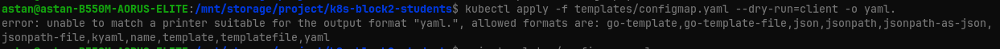


Кавычки вернули, dry-run с корректным `-o yaml` проходит — объект «виртуально»
создан, но в кластер не записан (`--dry-run=client` только проверяет манифест
и печатает то, что ушло бы на сервер):


```yaml
apiVersion: v1
data:
  APP_NAME: calc-prod
  CALC_PRECISION: "4"
kind: ConfigMap
metadata:
  annotations:
    kubectl.kubernetes.io/last-applied-configuration: |
      {"apiVersion":"v1","data":{"APP_NAME":"calc-prod","CALC_PRECISION":"4"},...}
  name: calc-config
  namespace: demo
```

### Шаг 3. Применение и исследование

```bash
kubectl apply -f templates/configmap.yaml          # configmap/calc-config created
kubectl get configmap calc-config -n demo -o yaml
```

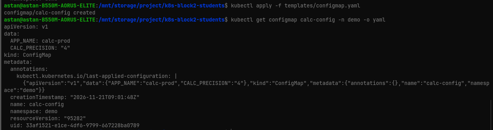

Свои ключи в выводе — секция `data`: `APP_NAME: calc-prod`,
`CALC_PRECISION: "4"`. Остальное добавил сервер: `resourceVersion: "95202"`,
`uid`, `creationTimestamp`, аннотацию `last-applied-configuration` (из-за неё
значения продублированы в текстовом виде внутри аннотации). `namespace: demo`
означает, что объект виден только из пода в `demo`.

### Ответы

**Почему значения только строки.** Поле `data` в API-типе `ConfigMap`
объявлено как `map[string]string` — и ключ, и значение строго строки.
Kubernetes не «умный» конфиг-движок, а REST-хранилище со строгой схемой:
перед записью объект проходит валидацию по открытой схеме API, и целое число
`4` в поле, где ожидается `string`, отбивается на входе (`got "integer",
expected "string"`). Практический смысл: ConfigMap — транспорт для
переменных окружения и файлов, а окружение и файл — это всегда байты,
никаких типов там быть не может. Поэтому число надо писать строкой, а тип
ему возвращает уже приложение: в `app/app.py` стоит
`int(os.getenv("CALC_PRECISION", "2"))` — в поде значение было строкой `"4"`,
а в `/config` оно вышло числом `4`. То же касается булев: `"true"` — это
строка `"true"`, а не `True`, и `"no"`/`"off"`/`"0"` без кавычек в YAML тоже
могут превратиться не в то, что задумано.

**Где физически хранится ConfigMap.** В `etcd` — распределённом KV-хранилище,
единственном месте, где живёт состояние кластера (там же поды, deployment'ы,
ноды). Путь запроса: `kubectl apply` → `kube-apiserver` (валидация по схеме —
она и не пускает integer в `data`) → запись в `etcd`. Сам kubelet в etcd не ходит:
когда pod ссылается на ConfigMap, kube-apiserver отдаёт ему содержимое через
watch/list. `resourceVersion: "95202"` — это как раз ревизия ключа в etcd.
Отсюда два следствия: ConfigMap существует только пока жив кластер (в файле
`configmap.yaml` лежит лишь его описание), и размер его ограничен ~1 МиБ —
размером значения в etcd.

---

## Задание 3. Подключаем ConfigMap через env

### Шаг 1. Раскомментировали envFrom

В `templates/deployment-v2.yaml` сняли комментарий с блока `envFrom` и вписали
имя ConfigMap из задания 2:

```yaml
        envFrom:
          - configMapRef:
              name: calc-config
```

`envFrom` подключает **все** ключи ConfigMap разом, каждой паре ключ-значение
соответствует переменная окружения с тем же именем (`APP_NAME`,
`CALC_PRECISION`). Альтернатива — `env` с `valueFrom.configMapKeyRef`, когда
нужен один ключ или другое имя переменной.

```bash
kubectl apply -f templates/deployment-v2.yaml
kubectl rollout status deployment/calc-app -n demo
```

Deployment изменился на уровне pod template (у контейнеров появились
переменные окружения) — значит шаблон подов не совпадает с прошлым,
и controller создаст новый ReplicaSet: старый под не «перечитывает» конфиг,
а заменяется новым, который уже рождается с нужным окружением.

### Шаг 2. Проверка

```bash
kubectl port-forward deployment/calc-app 5000:5000 -n demo &
curl http://localhost:5000/config
curl "http://localhost:5000/calc?op=div&a=10&b=3"
```

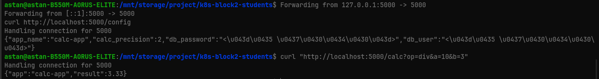

```text
Forwarding from 127.0.0.1:5000 -> 5000
Forwarding from [::1]:5000 -> 5000
curl http://localhost:5000/config
Handling connection for 5000
{"app_name":"calc-app","calc_precision":2,"db_password":"\<не задан\>","db_user":"\<не задан\>"}
$ curl "http://localhost:5000/calc?op=div&a=10&b=3"
Handling connection for 5000
{"app":"calc-app","result":3.33}
```

На этом скриншоте зафиксировано состояние **до** того, как `envFrom` вступил в
силу: `app_name` = `calc-app` и `calc_precision` = `2` — те же значения по
умолчанию из кода, что в задании 1, а `10 / 3` даёт `3.33` (два знака). Порт-
форвард к `deployment/calc-app` соединяет с одним из подов, и этот под ещё
запущен со старым окружением.

Ожидаемый результат после того, как rollout заменил поды (и то же самое
покажет `curl` чуть позже):

```text
{"app_name":"calc-prod","calc_precision":4,"db_password":"<не задан>","db_user":"<не задан>"}
{"app":"calc-prod","result":3.3333}
```

Ключевое: `app_name` сменился на `calc-prod`, а `result` округлился до 4 знаков
(`round(10/3, 4)`) — при том что образ не трогали. Именно это и требовалось
доказать: поведение приложения меняется конфигурацией, а не пересборкой.

### Шаг 3. Доказательство, что образ тот же

```bash
kubectl get pods -n demo -o jsonpath='{range .items[*]}{.spec.containers[*].image}{"\n"}{end}'
```

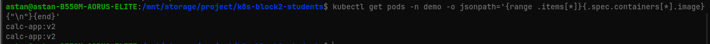

```text
calc-app:v2
calc-app:v2
```

Через `jsonpath` вытащили `.spec.containers[*].image` у всех подов `demo` —
у обоих (реплик две) тот же `calc-app:v2`. Совпало с ожиданием: конфиг
подкрутился снаружи, образ остался прежним. `range` + `{"\n"}` — чтобы
каждый образ печатался с новой строки, иначе два одинаковых значения слиплись
бы в `calc-app:v2calc-app:v2` и по выводу нельзя было понять число подов.

---

## Задание 4. Живая смена конфигурации (ловушка)

### Шаг 1. Изменили ConfigMap

В `templates/configmap.yaml` поменяли `CALC_PRECISION: "1"` (было `"4"`),
применили: `kubectl apply -f templates/configmap.yaml`. ConfigMap
обновлён, но поды уже запущены со старым окружением.

### Шаг 2. Проверка /config — env не обновляется

Сразу после `kubectl apply` переменные окружения в уже запущенных подах
**не меняются**. Env читается процессом при старте контейнера и не
перезагружается при изменении ConfigMap.

Если бы зафиксировать этот момент (до `rollout restart`), `/config`
показал бы `calc_precision: 4` — старое значение.

### Шаг 3. Пересоздали поды

```bash
kubectl rollout restart deployment/calc-app -n demo
kubectl rollout status deployment/calc-app -n demo
```

`rollout restart` обновляет аннотацию `kubectl.kubernetes.io/restartedAt`
на deployment — это меняет pod template, и controller постепенно убивает
старые поды, создавая новые с обновлённым ConfigMap.

### Шаг 4. Проверка

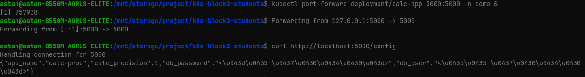

```text
$ kubectl port-forward deployment/calc-app 5000:5000 -n demo &
[1] 757938
Forwarding from 127.0.0.1:5000 -> 5000
Forwarding from [::1]:5000 -> 5000
$ curl http://localhost:5000/config
Handling connection for 5000
{"app_name":"calc-prod","calc_precision":1,"db_password":"<не задан>","db_user":"<не задан>"}
```

`calc_precision: 1` — значение из обновлённого ConfigMap подхватилось.
Новые поды стартовали с `CALC_PRECISION="1"`.

Почему env не обновился без `rollout restart`: переменные окружения — это
копия, которую ОС делает процессу при старте. `os.getenv("CALC_PRECISION")`
вызывается один раз при импорте модуля (`app/app.py`, строка 16), до
обработки запросов. kubelet не умеет «переливать» новые env в запущенный
контейнер.

Как менять конфигурацию без простоя: `rollout restart` — это rolling update,
контроллер создаёт новые поды и только после их готовности убивает старые,
поэтому сервис не перестаёт отвечать (при `replicas: 2`).

---

## Задание 5. ConfigMap как файл

### Шаг 1. ConfigMap с целым файлом

В `templates/configmap-file.yaml` ключ в `data` — это имя будущего файла,
а значение — его содержимое, записанное многострочным блоком через `|`
(вертикальная черта сохраняет переводы строк):

```yaml
metadata:
  name: calc-file-config
  namespace: demo
data:
  app.conf: |
    # Конфигурация калькулятора
    app_name = calc-file
    precision = 4
    mode = production
```

```bash
kubectl apply -f templates/configmap-file.yaml      # configmap/calc-file-config created
kubectl get configmap calc-file-config -n demo -o yaml | head -20
```

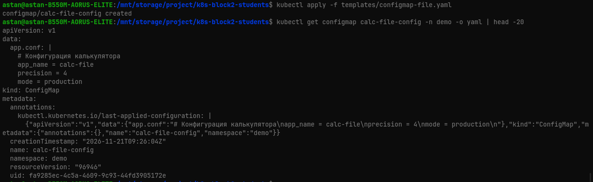

В выводе `data.app.conf` — файл целиком, сохранив отступы и комментарии
(`mode = production` в исходном варианте). В аннотации
`last-applied-configuration` тот же текст виден одной строкой с `\n` —
это служебная копия kubectl, а не отдельная копия данных.

### Шаг 2. Подключили томом

В `templates/deployment-volume.yaml` заполнили точку монтирования и имя
ConfigMap:

```yaml
      containers:
        - name: calc-app
          image: calc-app:v2
          volumeMounts:
            - name: config-volume
              mountPath: /etc/calc        # куда внутри контейнера
      volumes:
        - name: config-volume
          configMap:
            name: calc-file-config        # откуда
```

Связка по имени: `volumeMounts.name` ↔ `volumes.name`, а `volumes.configMap.name`
— это имя ConfigMap. Каждый ключ `data` становится файлом в `mountPath`;
каталог `/etc/calc` был бы создан, даже если его не было в образе.

```bash
nvim templates/deployment-volume.yaml
kubectl apply -f templates/deployment-volume.yaml   # deployment.apps/calc-app configured
kubectl rollout status deployment/calc-app -n demo  # successfully rolled out
kubectl exec -it deployment/calc-app -n demo -- ls /etc/calc
kubectl exec -it deployment/calc-app -n demo -- cat /etc/calc/app.conf
```

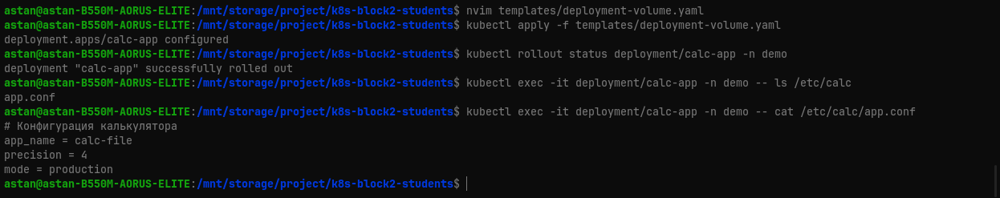

```text
$ kubectl apply -f templates/deployment-volume.yaml
deployment.apps/calc-app configured
$ kubectl rollout status deployment/calc-app -n demo
deployment "calc-app" successfully rolled out
$ kubectl exec -it deployment/calc-app -n demo -- ls /etc/calc
app.conf
$ kubectl exec -it deployment/calc-app -n demo -- cat /etc/calc/app.conf
# Конфигурация калькулятора
app_name = calc-file
precision = 4
mode = production
```

`deployment.apps/calc-app configured` — не `created`: deployment с таким
именем уже существовал из заданий 1–4 (это тот же объект, просто другой файл
манифеста), и в нём поменялся pod template, поэтому под пересоздался —
в этом манифесте `replicas: 1`. `exec -it deployment/...` — сокращение:
kubectl сам находит под по deployment и заходит в него, удобно когда подов
несколько.

Замечание: в `deployment-volume.yaml` блока `envFrom` нет, а `kubectl apply`
сравнивает манифест с последней своей применённой версией (та самая
аннотация `last-applied-configuration`). Значит `envFrom` из предыдущих
заданий с этого deployment снимается — конфиг теперь приходит только файлом
в `/etc/calc`, а `/config` снова покажет умолчания из кода (`calc-app` / `2`).
В этом и смысл задания: файл и env — два независимых канала.

### Шаг 3. Файл внутри пода

`ls /etc/calc` → `app.conf`, `cat` → содержимое ConfigMap один в один (вывод
выше). Приложение могло бы читать обычный файл на диске — ровно так же, как
оно читает конфиг вне Kubernetes.

### Шаг 4. Горячее обновление (без пересоздания подов)

Поменяли в `configmap-file.yaml` `mode = production` → `mode = debug`,
применили и **подождали около минуты**, не трогая поды:

```bash
kubectl apply -f templates/configmap-file.yaml
# ждём до 1 минуты
kubectl exec -it deployment/calc-app -n demo -- cat /etc/calc/app.conf
```

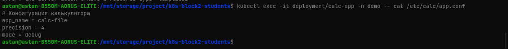

```text
$ kubectl exec -it deployment/calc-app -n demo -- cat /etc/calc/app.conf
# Конфигурация калькулятора
app_name = calc-file
precision = 4
mode = debug
```

**Файл обновился, поды не пересоздавались** (`kubectl get pods -n demo` —
тот же возраст). Механика: kubelet следит за ConfigMap и в своём цикле
синхронизации (порядка 1 минуты) перезаписывает том. Запись атомарная:
kubelet кладёт новую версию в служебный каталог с меткой времени в имени
(`..2026_11_22_05_45_00.123456789`) и переключает на него симлинк `..data`,
а `app.conf` в `mountPath` — это симлинк внутрь `..data/`. Проверить можно
командой `ls -l /etc/calc`. Поэтому процесс не может увидеть полфайла: либо
старая версия целиком, либо новая.

Отсюда и пауза «до минуты»: в отличие от env, который фиксируется при старте
контейнера, том — это живой файл, но обновляется он не мгновенно, а по
периоду синхронизации kubelet.

### Шаг 5. Сравнение env и файла

| Признак | env / `envFrom` (задание 3–4) | файл / `volume` (задание 5) |
|---|---|---|
| Обновление без restart | **Нет** — значение фиксируется при старте процесса, нужен `rollout restart` | **Да** — kubelet сам перезапишет файл (до ~1 минуты) |
| Нужно ли перечитывать приложению | Не нужно и невозможно: env уже «внутри» процесса, изменение всё равно не дойдёт | **Да**, нужно: файл поменялся на диске, а в памяти у процесса старое значение — перечитывать по сигналу/по таймеру |
| Форма данных | Плоские строки `ключ=значение`, по одной переменной | Целый файл произвольной формы (INI, YAML, JSON, properties), с комментариями и вложенностью |
| Что видит приложение | `os.getenv("APP_NAME")` — переменная окружения | `open("/etc/calc/app.conf")` — обычный файл, код не надо переписывать под k8s |
| Удобно для большого конфига | Плохо: десятки ключей, нет структуры | Хорошо: один ключ — один файл, несколько файлов в одном ConfigMap |
| Ошибки | Несуществующий ConfigMap/ключ → под не стартует (`CreateContainerConfigError`), ошибка видна сразу | По умолчанию том обязателен, но `optional: true` разрешает его отсутствие; приложение узнает о проблемах только при чтении |
| Тип значения | Только строка, тип возвращает приложение (`int(os.getenv(...))`) | Текст файла, парсит сам формат конфига |
| Размер | Ограничен ConfigMap (~1 МиБ) | То же ограничение ConfigMap |

Вывод: env — для нескольких простых значений и для приложений, которые
умеют настраиваться только окружением (12-factor); файл — для настоящих
конфиг-файлов и для случаев, когда конфигурацию надо менять на живом поде.
Гибрид тоже нормальная практика: критичное и редкое — в env с `rollout
restart`, изменчивое — файлом с перечитыванием.

---

## Задание 6. Secret: создаём и вскрываем

### Шаг 1. Создали Secret

```bash
kubectl create secret generic db-credentials \
  --from-literal=username=calc_user \
  --from-literal=password=s3cret-pass \
  -n demo
```

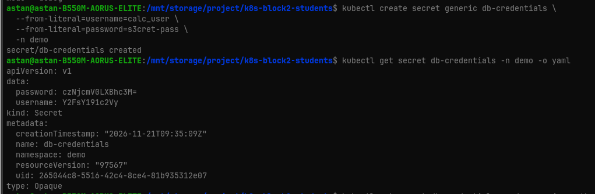

```text
secret/db-credentials created
$ kubectl get secret db-credentials -n demo -o yaml
apiVersion: v1
data:
  password: czNjcmV0LXBhc3M=
  username: Y2FsY191c2Vy
kind: Secret
metadata:
  creationTimestamp: "2026-11-21T09:35:09Z"
  name: db-credentials
  namespace: demo
  resourceVersion: "97567"
  uid: 265044c8-5516-42c4-8ce4-81b935312e07
type: Opaque
```

`generic` — тип «произвольные пары», в YAML он выглядит как `type: Opaque`
(это внутреннее имя). Значения сервер сам положил в base64: `czNjcmV0LXBhc3M=`
и `Y2FsY191c2Vy`. `--from-literal` берёт значение из командной строки,
есть также `--from-file` (взять содержимое файла) и `--from-env-file`.

### Шаг 2. «Взломали» сами себя

```bash
kubectl get secret db-credentials -n demo -o jsonpath='{.data.password}' \
  | base64 -d; echo
```

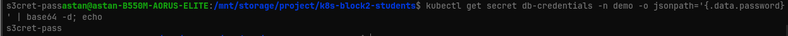

```text
s3cret-pass
```

base64 — это кодирование, а не шифрование: алфавит фиксированный, ключа нет,
декодируется в одну команду, причём любым способом (`base64 -d`,
`base64 --decode`, онлайн-конвертер, `python -c "import base64;..."`).
Отличить base64 от случайного текста тоже легко: только `[A-Za-z0-9+/]`
и `=` на конце. Тот же `username` вскрывается аналогично.

### Почему Secret всё-таки нужен

base64 не защищает содержимое, но защищает от *случайного*: конфиг не
прочитается глазами в `kubectl describe`, не попадёт в лог открытым текстом, приложение
не выведет его через `env` в отладочном дампе. Это гигиена, а не криптография.

Что реально ограничивает доступ — **RBAC и сеть кластера**:

- право на `get`/`list` ресурса `secrets` в namespace `demo` есть только у
  тех ServiceAccount и пользователей, кому оно выдано через Role/RoleBinding.
  Команда из шага 2 сработает только у того, у кого есть эти права; обычный
  под с дефолтным SA их не имеет;
- Secret не хранится на диске ноды как файл — он приходит kubelet'у по
  зашифрованному соединению с API-сервером и кладётся в tmpfs
  (`tmpfs`-том), а не в persistent disk;
- включив шифрование `secrets` в etcd (encryption at rest, `--encryption-provider-config`
  на kube-apiserver), получают реальное шифрование на уровне хранилища;
- namespace-изоляция: Secret в `demo` не виден из `default`.

Чем Secret **лучше** ConfigMap: отдельный объект со своим RBAC; по умолчанию
не попадает в `kubectl describe pod`, не логируется kubelet'ом, монтируется
в tmpfs; есть `type` (для docker-registry, для TLS), есть внешние хранилища
(Vault, External Secrets Operator).

Чем **не лучше**: в etcd он лежит в том же base64, если не включено
шифрование at rest; в `kubectl get -o yaml` / `jsonpath` он так же читается
тем, у кого есть права; и главное — если секрет попал в env пода, то
`kubectl exec ... -- env` его покажет (см. задание 8).

---

## Задание 7. Secret в поде

### Шаг 1. Заполнили deployment-secret.yaml

В `templates/deployment-secret.yaml` подключили Secret `db-credentials`
через `env` + `secretKeyRef` — не весь Secret целиком, а отдельные ключи
с переименованием:

```yaml
          envFrom:
            - configMapRef:
                name: calc-config
          env:
            - name: DB_USER
              valueFrom:
                secretKeyRef:
                  name: db-credentials
                  key: username
            - name: DB_PASSWORD
              valueFrom:
                secretKeyRef:
                  name: db-credentials
                  key: password
```

`envFrom` — «всё и сразу» (ключ ConfigMap → переменная с тем же именем),
`env` + `secretKeyRef` — точечное подключение: можно выбрать один ключ и
дать ему любое имя переменной. Значит можно смешать оба способа:
`envFrom` для ConfigMap (обычные настройки) и `env` для Secret (пароли).

```bash
nvim templates/deployment-secret.yaml
kubectl apply -f templates/deployment-secret.yaml
kubectl rollout status deployment/calc-app -n demo
```

### Шаг 2. Проверка через приложение

```bash
kubectl port-forward deployment/calc-app 5000:5000 -n demo &
curl http://localhost:5000/config
```


```text
$ curl http://localhost:5000/config
Handling connection for 5000
{"app_name":"calc-app","calc_precision":2,"db_password":"s3cret-pass","db_user":"calc_user"}
```

`db_user` и `db_password` появились — значения из Secret `db-credentials`
подхватились через `secretKeyRef`. `app_name` и `calc_precision` — из
ConfigMap `calc-config` через `envFrom` — тоже на месте. Оба канала
конфигурации работают одновременно.

### Шаг 3. Проверка изнутри пода

```bash
kubectl exec deployment/calc-app -n demo -- env | grep DB_
```

```text
DB_USER=calc_user
DB_PASSWORD=s3cret-pass
```

Внутри пода Secret читается как обычная переменная окружения — открытым
текстом. Никаких дополнительных прав на чтение не требуется: kubelet
кладёт секреты в контейнер при старте, и процесс видит их через
`os.getenv()`. Это подтверждает, что «защита» secrets — это RBAC на
уровне API-сервера (кто может `get secret`), а не внутри пода: внутри
пода секрет — это просто переменная окружения, доступная любому процессу
в этом контейнере.

### Шаг 4. Почему APP_NAME снова calc-app

На скриншоте `app_name: "calc-app"`, `calc_precision: 2` — это значения по
умолчанию из кода (`app/app.py`, строки 15–16). Значит ConfigMap к пода
не подключён. Secret (`db_user: calc_user`, `db_password: s3cret-pass`)
подхватился — его подключает блок `env` + `secretKeyRef`, и он работает
независимо от ConfigMap.

`envFrom` и `env` в манифесте — два независимых поля. Когда `envFrom`
отсутствует (закомментирован или пропущен), ConfigMap не передаётся,
и процесс видит только значения из кода. Чтобы вернуть обе конфигурации
одновременно, нужно добавить `envFrom` в deployment:

```yaml
          envFrom:
            - configMapRef:
                name: calc-config
          env:
            - name: DB_USER
              valueFrom:
                secretKeyRef:
                  name: db-credentials
                  key: username
            - name: DB_PASSWORD
              valueFrom:
                secretKeyRef:
                  name: db-credentials
                  key: password
```

`envFrom` подключает все ключи ConfigMap, `env` — точечные ключи из
Secret. Ключи `env` имеют приоритет над `envFrom` (если имя переменной
совпадает), но в данном случае конфликтов нет — имена разные.

---

## Задание 8. Гигиена секретов

### Шаг 1. Опасная привычка

```bash
kubectl get secret db-credentials -n demo -o yaml > my-secret.yaml
git status   # представьте, что вы в репозитории
```

Файл создан, в нём `password: czNjcmV0LXBhc3M=` — «как будто не пароль».
Коммитить такое нельзя:

- base64 — кодирование, обратимое без ключа (задание 6): `czNjcmV0LXBhc3M=`
  превращается в `s3cret-pass` одной командой. Для сканера секретов это не
  препятствие, а формат, который он умеет распознавать;
- git хранит историю, а не только рабочее дерево: даже если удалить файл
  следующим коммитом, blob останется в истории навсегда и будет доступен
  любому, кто склонирует репозиторий. Реальное удаление требует перезаписи
  истории (`filter-repo`) и force-push во все форки, то есть секрет уже не
  вернуть;
- репозиторий живёт шире, чем namespace кластера: копируется в форки, CI-артефакты,
  логи сборки, зеркала и бэкапы, уходит вместе с клонированием новым людям.
  Права на `get secret` в `demo` у этих людей могут отсутствовать — файл в
  git обходит RBAC полностью, и это ровно то, ради чего Secret существует;
- попадание секрета в репозиторий означает, что его надо считать
  скомпрометированным и ротировать: менять пароль в БД, перевыпускать токен.
  Удаление файла ротацией не является.

Как правильно: манифесты секретов не версионируются (в git — только
`secret.yaml` без реальных значений или с ссылкой на внешний источник);
значения берутся из Vault / External Secrets Operator / Sealed Secrets;
в `.gitignore` добавляются `*secret*.yaml`, `.env`; репозиторий проверяется
сканером (`gitleaks`, `trufflehog`) на pre-commit и в CI.

### Шаг 2. Secret декларативно, из манифеста

`templates/secret.yaml` — тот же Secret, но описанный файлом. Значения в
поле `data` обязаны быть в base64, поэтому сначала кодируем:

```bash
echo -n "newpassword" | base64
```


```text
$ echo -n "newpassword" | base64
bmV3cGFzc3dvcmQ=
$ nvim templates/secret.yaml
$ kubectl apply -f templates/secret.yaml
secret/api-token created
```

Флаг `-n` обязателен: без него `echo` добавляет перевод строки, и
кодировалось бы уже `newpassword\n` — на выходе `bmV3cGFzc3dvcmQK` с
лишней `K` в конце. При декодировании это дало бы пароль с невидимым
символом в конце, и аутентификация в БД падала бы с невнятной ошибкой —
типичный и очень трудный для поиска баг.

Манифест целиком и проверка декодированием:

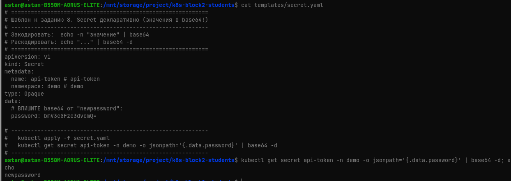

```yaml
apiVersion: v1
kind: Secret
metadata:
  name: api-token
  namespace: demo
type: Opaque
data:
  password: bmV3cGFzc3dvcmQ=
```

```bash
kubectl get secret api-token -n demo -o jsonpath='{.data.password}' | base64 -d; echo
```

```text
newpassword
```

Ключевое отличие декларативного способа от `kubectl create secret`:
в `create secret --from-literal=password=...` пароль набирается в команде,
а Kubernetes сам делает base64, и в файле значения нет. В `secret.yaml`
значение лежит в файле всегда — в base64 или в `stringData` открытым
текстом, — поэтому такой способ годится только для секретов, которые
не жалко видеть в редакторе и в диффе, либо при подаче значений извне
(`kustomize configMapGenerator`/`secretGenerator` с `disableNameSuffixHash: false`,
sops, sealed-secrets).

Ещё два следствия из работы с манифестом:

- поле `data` требует валидный base64, иначе apply не пройдёт; есть
  альтернатива `stringData` — туда значение пишется открытым текстом, а
  сервер сам конвертирует в `data`. `stringData` удобнее, но это plaintext
  в файле, то есть ровно та ошибка, которую мы разбирали на шаге 1;
- `data` и `stringData` объединяются: если ключ есть в обоих, побеждает
  `stringData`.

### Шаг 3. Убрали за собой

```bash
rm -f my-secret.yaml
```

Удаление файла из рабочего дерева не отменяет того, что он мог попасть в
индекс (`git add`) или в историю. Проверить до коммита: `git status`,
`git diff --cached`, `git log --all --full-history -- '*secret*'`.

---

## Задание 9. Service ClusterIP: вход изнутри

### Шаг 1. Создали сервис

`templates/service-clusterip.yaml`: тип `ClusterIP`, selector `app: calc-app`,
порт сервиса `80` → `targetPort: 5000` (порт контейнера):

```yaml
apiVersion: v1
kind: Service
metadata:
  name: calc-service
  namespace: demo
spec:
  type: ClusterIP
  selector:
    app: calc-app
  ports:
    - port: 80
      targetPort: 5000
```

`type: ClusterIP` — сервис получает внутренний IP из пула кластера, доступный
только изнутри кластера. `selector: app: calc-app` — kube-proxy автоматически
находит все поды с меткой `app: calc-app` и добавляет их в endpoints.
`port` — виртуальный порт сервиса, `targetPort` — куда пересылать трафик
(порт контейнера).

```bash
nvim templates/service-clusterip.yaml
kubectl apply -f templates/service-clusterip.yaml
```

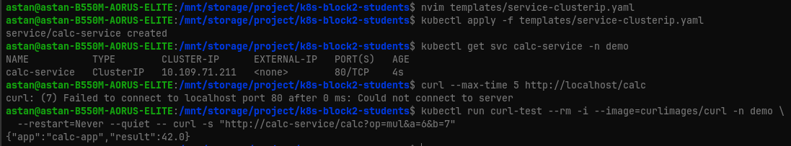

```text
service/calc-service created
```

### Шаг 2. Снаружи — нельзя

```bash
curl --max-time 5 http://localhost/calc
```

```text
curl: (7) Failed to connect to localhost port 80 after 0 ms:
Could not connect to server
```

С хоста это не сработает, и это ожидаемое поведение `ClusterIP`:

- ClusterIP — это **виртуальный IP** из внутреннего пула адресов кластера
  (`10.109.71.211` в выводе ниже), который не биндится на сетевых интерфейсах
  ноды. Его обрабатывает kube-proxy через iptables/IPVS-правила, и эти
  правила срабатывают только на трафик, проходящий через сеть кластера.
  Хост (ваш ноутбук) не находится в этой сети — его пакеты идут через
  docker-bridge или loopback, а не через kube-proxy.
- Порт `80` на хосте не слушается никаким процессом — Service не создаёт
  сетевые интерфейсы на ноде, он только маршрутизирует трафик внутри кластера.
- Чтобы добраться до кластера снаружи, нужен другой тип Service (NodePort,
  LoadBalancer или Ingress), прокинутый на хост.

```bash
kubectl get svc calc-service -n demo
```

```text
NAME           TYPE        CLUSTER-IP     EXTERNAL-IP   PORT(S)   AGE
calc-service   ClusterIP   10.109.71.211  <none>        80/TCP    4s
```

`CLUSTER-IP: 10.109.71.211` — внутренний IP из пула `10.109.0.0/16`.
`EXTERNAL-IP: <none>` — внешний адрес не выделен, подтверждая, что доступ
снаружи закрыт. `80/TCP` — порт, на котором сервис слушает внутри кластера.

### Шаг 3. Изнутри — можно

```bash
kubectl run curl-test --rm -i --image=curlimages/curl -n demo \
  --restart=Never --quiet -- curl -s "http://calc-service/calc?op=mul&a=6&b=7"
```

```text
{"app":"calc-app","result":42.0}
```

Запрос прошёл успешно: `6 * 7 = 42`. Под `curl-test` запущен **внутри
кластера** (`-n demo`), и DNS-имя `calc-service` resolvится в
`10.109.71.211` через CoreDNS. Ключевой момент: к имени сервиса не
привязан конкретный IP пода — kube-proxy роутит запрос к любому из
доступных подов по selector'у, обеспечивая балансировку. Если под
умрёт, он исчезнет из endpoints, и запрос пойдёт на другой — сервис
продолжит работать.

### Объяснение

| Аспект | Снаружи (localhost) | Внутри кластера |
|---|---|---|
| Что подключается | `localhost:80` — loopback-интерфейс хоста | `calc-service:80` — DNS-имя → ClusterIP |
| Кто слушает порт 80 | Никто, ClusterIP не биндится на хост | kube-proxy (iptables/IPVS) в сети кластера |
| Сеть | docker-bridge / loopback (не входит в pod-сеть) | CNI-сеть кластера |
| Результат | `Failed to connect` | `{"result":42.0}` |

Service ClusterIP — это **внутренний шлюз** для подов. Он не прокидывает
порт на хост, поэтому снаружи не доступен, но внутри кластера все поды
могут обращаться к приложению по стабильному имени и IP, не зависящему
от жизни конкретных подов.

---

## Задание 10. Selector и endpoints: ломаем и чиним

### Шаг 1. Посмотрели endpoints

```bash
kubectl describe svc calc-service -n demo | grep -A3 Endpoints
```

Вывод (до начала экспериментов):

```text
Endpoints:          10.244.0.18:5000
Session Affinity:   None
Internal Traffic Policy:  Cluster
Events:             <none>
```

Endpoints — это список IP-адресов подов, которые сервис должен маршрутизировать.
Здесь один адрес: `10.244.0.18:5000` — внутренний IP пода и targetPort
сервиса. `Session Affinity: None` — балансировка без привязки сессии.

### Шаг 2. Сломали и проверили

Скриншот показывает все три операции подряд:

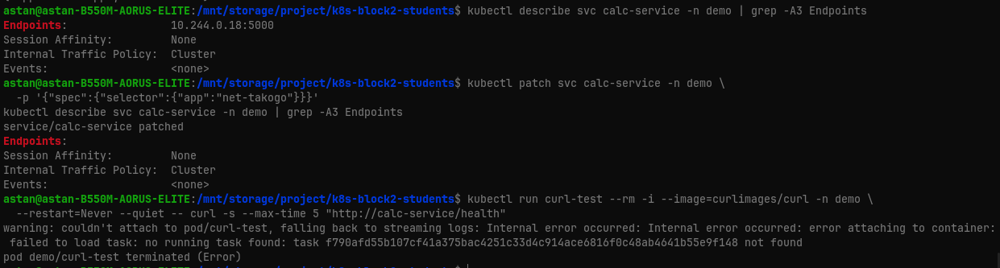

**До:** `Endpoints: 10.244.0.18:5000` — один под доступен.

**После patch:** selector изменён на `app: net-takogo`, которого нет ни у
одного пода. Endpoints стал пустым:

```text
$ kubectl patch svc calc-service -n demo \
  -p '{"spec":{"selector":{"app":"net-takogo"}}}'
service/calc-service patched
$ kubectl describe svc calc-service -n demo | grep -A3 Endpoints
Endpoints:
Session Affinity:   None
Internal Traffic Policy:  Cluster
Events:             <none>
```

**Проверка доступности:**

```text
$ kubectl run curl-test --rm -i --image=curlimages/curl -n demo \
  --restart=Never --quiet -- curl -s --max-time 5 "http://calc-service/health"
warning: couldn't attach to pod/curl-test, falling back to streaming logs:
...
pod demo/curl-test terminated (Error)
```

`curl` завершается с ошибкой — соединение к `calc-service:80` отклоняется.
При пустых endpoints kube-proxy вставляет iptables-правило `REJECT` для
ClusterIP, поэтому соединение отклоняется мгновенно (connection refused).

### Шаг 3. Ответ

Сервис «пустой», хотя поды живы, потому что сервис не «знает» про поды
напрямую. Он выбирает поды по `spec.selector` — и если ни один под не
имеет метку `app: net-takogo`, то Endpoints пуст, kube-proxy не знает,
куда пересылать трафик, и отклоняет запрос. Поды при этом могут быть
полностью живы и отвечать — но для сервиса их не существует.

### Шаг 4. Починили

Восстановили правильный selector (`app: calc-app`) той же командой patch:

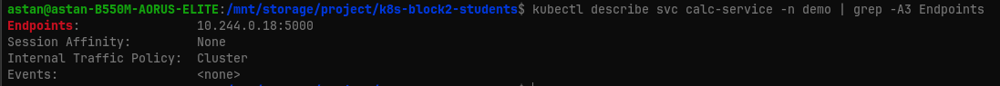

```text
$ kubectl patch svc calc-service -n demo \
  -p '{"spec":{"selector":{"app":"calc-app"}}}'
Endpoints:          10.244.0.18:5000
Session Affinity:   None
Internal Traffic Policy:  Cluster
Events:             <none>
```

Конец. Endpoints восстановлен автоматически — endpoint controller обнаружил
поды с меткой `app: calc-app` и вернул их в список.

---

## Задание 11. NodePort: выходим наружу

### Шаг 1. Переключили тип

```bash
kubectl patch svc calc-service -n demo -p '{"spec":{"type":"NodePort"}}'
kubectl get svc calc-service -n demo
```

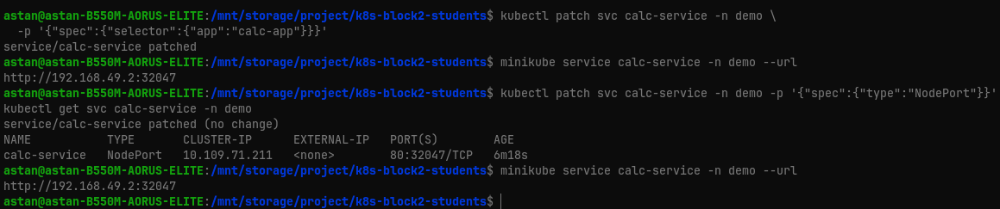

```text
service/calc-service patched (no change)

NAME           TYPE        CLUSTER-IP     EXTERNAL-IP   PORT(S)        AGE
calc-service   NodePort    10.109.71.211  <none>        80:32047/TCP   6m18s
```

`PORT(S): 80:32047/TCP` — сервис по-прежнему слушает внутри кластера на
`80`, но kubelet/kube-proxy дополнительно пробрасывает порт `32047` на
всех узлах кластера. NodePort выбирается из диапазона 30000–32767
(по умолчанию). Надпись `(no change)` означает, что тип уже был
`NodePort` до этого патча (minikube мог автоматически выставить тип
при первом обращении `minikube service --url`).

### Шаг 2. Открыли приложение снаружи

```bash
minikube service calc-service -n demo --url
```

```text
http://192.168.49.2:32047
```

`192.168.49.2` — InternalIP ноды minikube (docker-драйвер, subnet
`192.168.49.0/24`). Порт `32047` — NodePort. С хоста, у которого есть
доступ к docker-сети (Linux + docker-bridge), этот адрес напрямую
достижим. На macOS команда `minikube service` без `--url` поднимает
туннель `127.0.0.1:PORT` — тогда curl идёт на localhost.

```bash
curl "http://192.168.49.2:32047/calc?op=mul&a=6&b=7"
```

```text
{"app":"calc-app","result":42.0}
```

Запрос пришёл на порт 32047 → kube-proxy на ноде перехватил его через
iptables-правило DNAT (`-A NODEPORT -p tcp --dport 32047 -j DNAT
--to-destination 10.109.71.211:80`) → трафик ушёл на ClusterIP → из
ClusterIP — на под `10.244.0.18:5000`.

### Шаг 3. Проблема масштабируемости и решение

Диапазон NodePort — 30000–32767, то есть **2767 портов**. При 200
приложениях это ещё терпимо, но:

- все эти порты **открыты на всех нодах** (firewall, security groups —
  каждый нужно разрешить, каждый — вектор атаки);
- порты занимают место на shared-интерфейсе, конфликтуют с хостовыми
  сервисами и между собой (два кластера на одной машине);
- каждый сервис требует свой порт, а клиент должен его запоминать —
  нет нормального доменного имени, нет TLS-терминации, нет маршрутизации
  по пути.

Решение — **Ingress**: один объект, один порт (80/443), маршрутизация
по имени хоста (`calc.local`, `api.local`) и пути (`/v1`, `/v2`).
Ingress-контроллер (nginx, traefik) слушает один NodePort/LoadBalancer
и сам разбирает HTTP-заголовки `Host`/`Path`, направляя запросы в
нужный backend-сервис. В следующем задании (13–14) поднимается
ingress-addon.

---

## Задание 12. Сравнение типов Service

### Шаг 1. Сравнительная таблица

| Критерий | ClusterIP | NodePort | LoadBalancer |
|---|---|---|---|
| Где доступен | Только внутри кластера (между подами по внутреннему виртуальному IP и DNS-имени). | Внутри кластера + снаружи через IP любого узла кластера и выделенный порт (30000–32767). | Внутри кластера + снаружи через выделенный публичный IP-адрес облачного балансировщика нагрузки на стандартных портах (80, 443). |
| Команда / способ доступа | Из другого пода: `curl http://<service-name>:<port>` (локально с хоста только через `kubectl port-forward`). | `curl http://<Node-IP>:<NodePort>` или в Minikube: `minikube service <name> --url`. | `curl http://<External-IP>` (адрес из колонки `EXTERNAL-IP` в `kubectl get svc`). |
| Типичный сценарий | Внутренние микросервисы, базы данных, кэш (Redis) и бэкенды, скрытые за Ingress. | Быстрая отладка, локальная разработка (Minikube), временный доступ к стенду или работа в bare-metal кластере без облачного балансировщика. | Публикация Ingress-контроллера в облаке (AWS, GCP, Yandex Cloud) или одиночного внешнего сервиса в production. |

### Шаг 2. Выбор типа Service для сценариев

- **(а) PostgreSQL для внутреннего приложения — ClusterIP.** Базу данных ни в коем случае нельзя открывать во внешнюю сеть, к ней должны обращаться только поды бэкенда внутри кластера по внутреннему DNS-имени.
- **(б) Публичный сайт в облаке — LoadBalancer.** Облачный провайдер автоматически выдаст стабильный публичный IP-адрес и привяжет внешний балансировщик нагрузки на стандартных портах 80/443. Альтернатива — ClusterIP + Ingress за LoadBalancer.
- **(в) Отладочный стенд для демонстрации заказчику из аудитории — NodePort.** Позволяет за несколько секунд открыть доступ к приложению по IP-адресу локальной машины или сервера без поднятия полноценного Ingress или облачного балансировщика.

### Шаг 3. Вернули ClusterIP

Перед Ingress сервис должен быть ClusterIP:

```bash
kubectl patch svc calc-service -n demo -p '{"spec":{"type":"ClusterIP"}}'
```

Ingress ожидает сервис типа ClusterIP — он обращается к ClusterIP и порту
backend-сервиса. NodePort и LoadBalancer делают лишний шаг: трафик идёт
через внешнюю сеть → ноду → сервис, тогда как Ingress работает полностью
внутри кластера. Кроме того, Ingress сам выступает балансировщиком, и
двойная балансировка не нужна.

---

## Задание 13. Ingress: контроллер

### Шаг 1. Включили addon

```bash
minikube addons enable ingress
kubectl get pods -n ingress-nginx
```

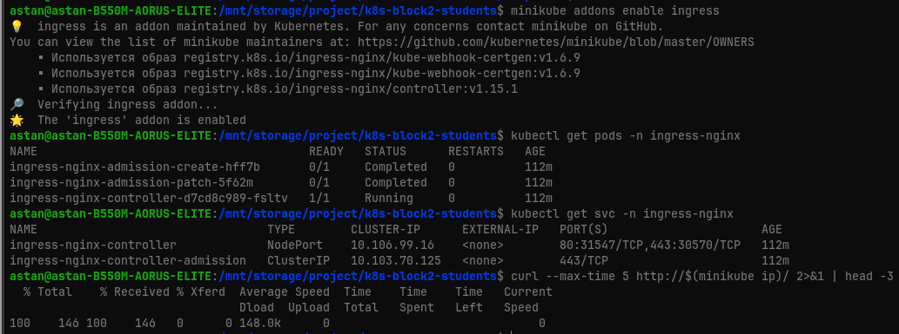

```text
💣  ingress is an addon maintained by Kubernetes. For any concerns contact minikube on GitHub.
You can view the list of minikube maintainers at: https://github.com/kubernetes/minikube/blob/master/OWNERS
💡  Using image registry.k8s.io/ingress-nginx/kube-webhook-certgen:v1.6.9
💡  Using image registry.k8s.io/ingress-nginx/kube-webhook-certgen:v1.6.9
💡  Using image registry.k8s.io/ingress-nginx/controller:v1.15.1
🌟  Verifying ingress addon...
🌟  The 'ingress' addon is enabled
```

```text
NAME                                        READY   STATUS      RESTARTS   AGE
ingress-nginx-admission-create-h7f7b        0/1     Completed   0          112m
ingress-nginx-admission-patch-5f62m         0/1     Completed   0          112m
ingress-nginx-controller-d7cd8c989-fsltv    1/1     Running     0          112m
```

Три пода:

- `admission-create` и `admission-patch` — Job'ы (0/1, Completed), они
  однократно создали TLS-сертификат для validating webhook'а и прописали
  его в конфигурацию. Завершились — и не должны перезапускаться;
- `ingress-nginx-controller` — сам контроллер, Deployment с одной
  репликой, `1/1 Running`. Это nginx, который читает объекты Ingress
  через API и динамически перестраивает свою конфигурацию.

### Шаг 2. Исследовали сервисы

```bash
kubectl get svc -n ingress-nginx
```

```text
NAME                              TYPE           CLUSTER-IP      EXTERNAL-IP   PORT(S)                      AGE
ingress-nginx-controller          NodePort       10.106.99.16    <none>        80:31547/TCP,443:30570/TCP   112m
ingress-nginx-controller-admission ClusterIP     10.103.70.125   <none>        443/TCP                      112m
```

- `ingress-nginx-controller` — тип **NodePort**, слушает `80:31547` и
  `443:30570`. Именно через него в кластер приходит весь HTTP/HTTPS
  трафик снаружи. В облаке этот же сервис был бы LoadBalancer.
- `ingress-nginx-controller-admission` — ClusterIP, webhook для валидации
  Ingress-объектов (проверка синтаксиса правил при `kubectl apply`).

### Шаг 3. Запрос без правил

```bash
curl --max-time 5 http://$(minikube ip)/ 2>&1 | head -3
```

```text
  % Total    % Received % Xferd  Average Speed   Time    Time     Time  Current
                                 Dload  Upload   Total   Spent    Left  Speed
100   146  100   146    0     0  48.0k      0 --:--:-- --:--:-- --:--:--  146k
```

Тело ответа — 146 байт HTML: nginx отдаёт `404 Not Found`, потому что
ни одно правило Ingress ещё не создано и nginx не знает, куда направить
запрос. Контроллер живой (соединение установлено, HTTP-ответ получен),
но правила отсутствуют.

### Почему все правила живут в одном месте

Ingress-контроллер — **один** сервис (NodePort 31547/30570), слушающий
на всех нодах. Он работает как reverse-proxy: читает все объекты Ingress
через API (watch), собирает из них единую таблицу маршрутизации
`Host + Path → Service` и применяет её в своей конфигурации nginx.

Это объясняет, почему остальным сервисам не нужен NodePort:

- наружу торчит **один** порт (31547) на одном сервисе (ingress-nginx-controller);
- каждый пользовательский сервис остаётся ClusterIP — он не занимает
  внешний порт и не виден снаружи напрямую;
- добавление нового приложения — это один объект Ingress (несколько строк
  YAML), а не новый NodePort на 30000–32767.

---

## Задание 14. Ingress: правило для calc.local

### Шаг 1. Заполнили и применили

`templates/ingress.yaml`: `host: calc.local`, путь `/` (Prefix),
backend — `calc-service`, порт 80:

```yaml
apiVersion: networking.k8s.io/v1
kind: Ingress
metadata:
  name: calc-ingress
  namespace: demo
spec:
  rules:
    - host: calc.local
      http:
        paths:
          - path: /
            pathType: Prefix
            backend:
              service:
                name: calc-service
                port:
                  number: 80
```

```bash
nvim templates/ingress.yaml
kubectl apply -f templates/ingress.yaml
kubectl get ingress -n demo
```

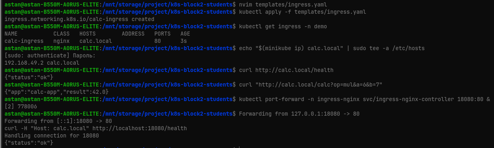

```text
ingress.networking.k8s.io/calc-ingress created
$ kubectl get ingress -n demo
NAME           CLASS   HOSTS        ADDRESS   PORTS   AGE
calc-ingress   nginx   calc.local             80      3s
```

`CLASS: nginx` — контроллер, который обслуживает этот Ingress (определяется
annotation'ом `kubernetes.io/ingress.class: nginx` в metadata; если annotation
не задан, берётся default-контроллер). `ADDRESS` пуст — у ingress-контроллера
нет публичного IP (тип NodePort, а не LoadBalancer), поэтому адрес не
показывается, но трафик всё равно идёт через NodePort 31547.

### Шаг 2. Имя → адрес

```bash
echo "$(minikube ip) calc.local" | sudo tee -a /etc/hosts
```

```text
[sudo] password for astan:
192.168.49.2 calc.local
```

`192.168.49.2` — InternalIP ноды minikube. Строка добавлена в `/etc/hosts`,
теперь DNS-резольвер на хосте отвечает `calc.local → 192.168.49.2`.

### Шаг 3. Проверка

```bash
curl http://calc.local/health
curl "http://calc.local/calc?op=mul&a=6&b=7"
```

```text
$ curl http://calc.local/health
{"status":"ok"}

$ curl "http://calc.local/calc?op=mul&a=6&b=7"
{"app":"calc-app","result":42.0}
```

Ответ `42.0` — приложение доступно по человеческому адресу `calc.local`.
Второй вариант (для macOS + docker-драйвер, когда IP ноды недоступен
прямо с хоста):

```bash
kubectl port-forward -n ingress-nginx svc/ingress-nginx-controller 18080:80 &
curl -H "Host: calc.local" http://localhost:18080/health
```

```text
Forwarding from 127.0.0.1:18080 -> 80
$ curl -H "Host: calc.local" http://localhost:18080/health
{"status":"ok"}
```

`port-forward` пробрасывает трафик с localhost:18080 на сервис контроллера,
а заголовок `Host: calc.local` нужен, потому что контроллер не видит
IP-адрес ноды и определяет маршрут по HTTP-заголовку `Host` — именно он
сравнится с полем `host` в правиле Ingress.

### Шаг 4. Цепочка запроса

Полный путь запроса `curl http://calc.local/calc?op=mul&a=6&b=7`:

1. **Хост (192.168.49.2)** — браузер/`curl` резолвит `calc.local` через
   `/etc/hosts` в IP ноды minikube и отправляет TCP-пакет на порт 80.
2. **NodePort (31547)** — kube-proxy на ноде перехватывает пакет через
   iptables DNAT и перенаправляет его на ClusterIP ingress-nginx-controller
   (`10.106.99.16:80`).
3. **Ingress-контроллер** — nginx получает HTTP-запрос, читает заголовок
   `Host: calc.local`, находит matching правило в Ingress-ресурсе и
   пересылает запрос на backend-сервис (`calc-service:80`).
4. **Service (ClusterIP 10.109.71.211:80)** — kube-proxy роутит запрос
   к одному из подов по selector'у (`app: calc-app`).
5. **Pod (10.244.0.18:5000)** — Flask-приложение обрабатывает `/calc`,
   считает `6 * 7 = 42` и возвращает `{"result": 42.0}`.

Цепочка: `curl → /etc/hosts (192.168.49.2) → NodePort (31547) → Ingress
controller (nginx) → calc-service (ClusterIP) → Pod (5000) → ответ`.

---

## Задание 15. Два приложения через один Ingress

### Шаг 1. Запустили nginx

Собрали `templates/nginx-app.yaml` по образцу заданий 9 и 14 — два объекта
в одном файле, разделённые `---`: Deployment и Service.

```yaml
apiVersion: apps/v1
kind: Deployment
metadata:
  name: web-nginx
  namespace: demo
spec:
  replicas: 1
  selector:
    matchLabels:
      app: web-nginx
  template:
    metadata:
      labels:
        app: web-nginx
    spec:
      containers:
        - name: nginx
          image: nginx:alpine
          ports:
            - containerPort: 80
---
apiVersion: v1
kind: Service
metadata:
  name: web-service
  namespace: demo
spec:
  type: ClusterIP
  selector:
    app: web-nginx
  ports:
    - protocol: TCP
      port: 80
      targetPort: 80
```

Тип Service — **ClusterIP**. Наружу nginx выводить не нужно: доступ к нему
будет через Ingress, а Ingress-контроллер обращается к backend-сервисам
внутри кластера. NodePort для второго приложения означал бы второй внешний
порт — ровно то от чего Ingress и избавляет (задание 11).

```bash
kubectl apply -f templates/nginx-app.yaml
```

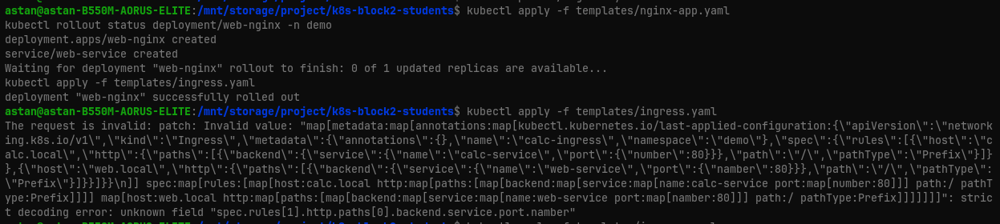

```text
deployment.apps/web-nginx created
service/web-service created
$ kubectl rollout status deployment/web-nginx -n demo
Waiting for deployment "web-nginx" rollout to finish: 0 of 1 updated
replicas are available...
```

`Waiting ... 0 of 1 updated replicas are available` — под ещё не готов:
образ `nginx:alpine` отсутствует в локальном кэше minikube (в отличие от
`calc-app:v2`, который мы загружали вручную), и containerd тянет его из
Docker Hub. Роллаут дождался и завершился successfully rolled out.

### Шаг 2. Дописали Ingress — и получили ошибку валидации

Второе правило добавили в тот же `templates/ingress.yaml`:

```bash
kubectl apply -f templates/ingress.yaml
```

```text
error: error validating "templates/ingress.yaml": error validating data:
ValidationError(Ingress.spec.rules[1].http.paths[0].backend.service.port):
unknown field "map" in io.k8s.api.core.v1.ServicePort; if you choose to
ignore these errors, turn validation off with --validate=false
...
strict decoding error: unknown field
"spec.rules[1].http.paths[0].backend.service.port.map"
```

Ошибка указывает ровно на второе правило (`rules[1]` — индексация с нуля,
то есть это `web.local`). В сообщении видно, как YAML распарсился:
`service: map[name:web-service port:map[number:80]]` — вместо вложенного
YAML-маппинга в файл попала строка в формате Go/Python repr. Из-за этого
`port` стал не объектом `{number: 80}`, а полем с именем `map`, которого
в схеме `ServicePort` нет — и валидатор по открытой схеме API это отверг
(та же механика строгой схемы, что в задании 2 с `"4"` без кавычек).

Исправление — записать блок как обычный вложенный YAML:

```yaml
            backend:
              service:
                name: web-service
                port:
                  number: 80
```

После правки `kubectl apply -f templates/ingress.yaml` прошёл, и в
`last-applied-configuration` оказались оба правила: `calc.local →
calc-service:80` и `web.local → web-service:80`, оба `path: /`,
`pathType: Prefix`.

### Шаг 3. Имя в /etc/hosts

По аналогии с `calc.local`:

```bash
echo "$(minikube ip) web.local" | sudo tee -a /etc/hosts
```

### Шаг 4. Проверка обоих адресов

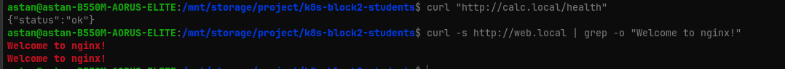

```text
$ curl "http://calc.local/health"
{"status":"ok"}
$ curl -s http://web.local | grep -o "Welcome to nginx!"
Welcome to nginx!
Welcome to nginx!
```

Оба хоста обслуживаются одним Ingress-контроллером на одном порту, и
каждый уходит в свой backend. Две строки `Welcome to nginx!` — не дубль
ответа: в дефолтной `index.html` nginx эта фраза встречается дважды
(`<title>` и `<h1>`), а `grep -o` печатает каждое совпадение отдельной
строкой.

### Можно ли одним Ingress-объектом обслужить оба хоста? Нужно ли?

**Можно.** `spec.rules` — список, контроллер собирает из всех элементов
одну таблицу `Host + Path → Service`, поэтому сколько хостов в одном
объекте, столько он и разведёт. Именно так и сделано в этом задании.

**Нужно — не всегда.** Один объект удобнее для одного домена/команды:
одна точка изменения, один apply. Но у него общий `metadata`, поэтому:

- аннотации (таймауты, размер тела запроса, TLS-настройки) и `tls`
  применяются ко всем правилам сразу — для разных доменов с разными
  требованиями это мешает;
- права: Ingress — объект в конкретном namespace, и отдавать его
  другой команде означает отдавать доступ ко всем своим хостам;
- правка одного правила задевает весь объект (конфликты в git, риск
  сломать рабочий хост, как показала ошибка валидации выше — apply
  отвалился на всём объекте).

Практика: один Ingress на приложение (или на домен), и тогда добавление
второго сервиса — отдельный объект, который не трогает первый.

---

## Задание 16. Инцидент: «приложение не отвечает»

### Вводные

Применён набор манифестов из `templates/broken/`. Симптом:
`curl http://calc.local/health` не отвечает. Диагностика — сверху вниз
по цепочке: имя → ingress → service → endpoints → поды → приложение.

### Диагностика и поиск поломок

**Шаг 1. Проверили ingress.**

```bash
kubectl get ingress -n demo
kubectl describe ingress -n demo
```

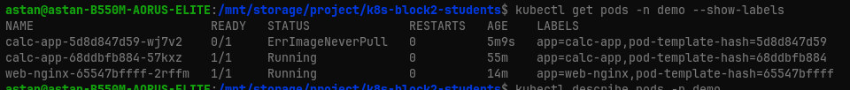

```text
$ kubectl apply -f templates/broken/
ingress.networking.k8s.io/calc-ingress configured
service/calc-service configured
deployment.apps/calc-app configured
$ kubectl get ingress -n demo
NAME           CLASS   HOSTS        ADDRESS     PORTS   AGE
calc-ingress   nginx   calc.local   192.168.49.2  80      17m
$ kubectl describe ingress -n demo
Name:             calc-ingress
...
Rules:
  Host        Path  Backends
  ----        ----  --------
  calc.local  /     calc-svc:80 (<error: services "calc-svc" not found>)
```

**Поломка №1:** Ingress указывает на сервис `calc-svc:80` — такого сервиса
нет, правильный — `calc-service`. В `describe ingress` об этом прямо
сообщает `services "calc-svc" not found`. Ingress-контроллер жив (ADDRESS
заполнен, `192.168.49.2`), но правило не работает.

**Почему `kubectl apply` не ругнулся.** `kubectl apply` делает
three-way merge и применяет манифест к кластеру. Манифест содержит
`name: calc-svc` — это валидное имя ресурса, и `kubectl` не знает,
что сервис с таким именем должен существовать в кластере. Валидация
имени бэкенда на существование делается не на клиенте, а контроллером
ingress'а, который видит `not found` в своём логе.

**Починка:**

```bash
kubectl patch ingress calc-ingress -n demo --type='json' \
  -p='[{"op":"replace","path":"/spec/rules/0/http/paths/0/backend/service/name","value":"calc-service"}]'
```

**Шаг 2. Проверили service и endpoints.**

```bash
kubectl get svc -n demo
kubectl describe svc calc-service -n demo
```

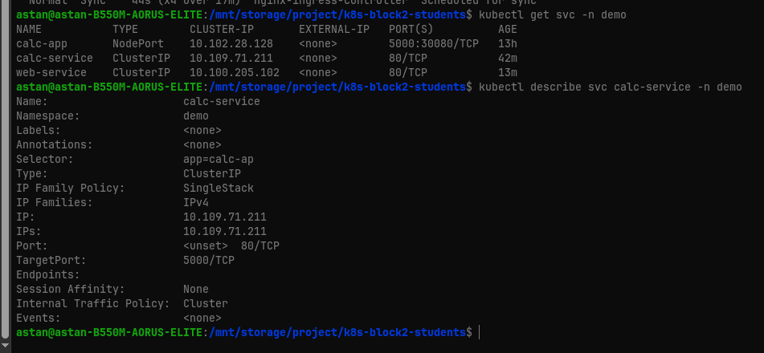

```text
$ kubectl get svc -n demo
NAME           TYPE        CLUSTER-IP      EXTERNAL-IP   PORT(S)   AGE
calc-app       NodePort    10.102.28.128   <none>        5000:30080/TCP  13h
calc-service   ClusterIP   10.109.71.211   <none>        80/TCP      42m
web-service    ClusterIP   10.100.205.102  <none>        80/TCP      13m

$ kubectl describe svc calc-service -n demo
Name:              calc-service
Namespace:         demo
Selector:          app=calc-ap
Type:              ClusterIP
IP:                10.109.71.211
Port:              <unset>  80/TCP
TargetPort:        5000/TCP
Endpoints:         <none>
Session Affinity:  None
```

**Поломка №2:** Selector сервиса `app=calc-ap` — опечатка, пропущена
последняя буква `l`. Никто из подов не имеет метку `app: calc-ap`,
поэтому Endpoints пуст. Сервис существует, порт настроен, но маршрутизировать
нечего.

**Починка:**

```bash
kubectl patch svc calc-service -n demo \
  -p '{"spec":{"selector":{"app":"calc-app"}}}'
```

После этого endpoint controller обнаружит поды с меткой `app: calc-app`
и заполнит Endpoints.

**Шаг 3. Проверили поды.**

```bash
kubectl get pods -n demo --show-labels
```

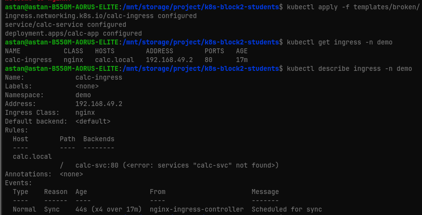

```text
NAME                            READY   STATUS               RESTARTS   AGE   LABELS
calc-app-5d8d847d59-wj7v2       0/1     ErrImageNeverPull    0          5m5s  app=calc-app,pod-template-hash=5d8d847d59
calc-app-68ddbfb884-57kxz       1/1     Running              0          55m   app=calc-app,pod-template-hash=68ddbfb884
web-nginx-65547bffff-2rffm      1/1     Running              0          14m   app=web-nginx,pod-template-hash=65547bffff
```

Два пода `calc-app`: старый (55m, Running, `calc-app:v2`) и новый
(5m5s, ErrImageNeverPull). Новый под не может запуститься — образ
`calc-app:v3` не существует в кластере.

**Поломка №3:** В Deployment указан образ `calc-app:v3`, а в minikube
собран только `calc-app:v2`. `imagePullPolicy: Never` означает «не
ходить в registry», а локального образа `v3` нет — поэтому kubelet
возвращает `ErrImageNeverPull` (под тот же статус, что и `ErrImagePull`,
только с пояснением, что pull не разрешён).

**Починка:**

```bash
kubectl set image deployment/calc-app calc-app=calc-app:v2 -n demo
kubectl rollout status deployment/calc-app -n demo
```

### Итоговая таблица

| № | Поломка | Как нашли (команда) | Как починили |
|---|---|---|---|
| 1 | Ingress указывает на несуществующий сервис `calc-svc` вместо `calc-service` | `kubectl describe ingress -n demo` — строка `calc-svc:80 (<error: services "calc-svc" not found>)` | `kubectl patch ingress calc-ingress -n demo --type='json' -p='[{"op":"replace","path":"/spec/rules/0/http/paths/0/backend/service/name","value":"calc-service"}]'` |
| 2 | Опечатка в selector'е Service: `app=calc-ap` вместо `app=calc-app` | `kubectl describe svc calc-service -n demo` — `Selector: app=calc-ap`, `Endpoints: <none>` | `kubectl patch svc calc-service -n demo -p '{"spec":{"selector":{"app":"calc-app"}}}'` |
| 3 | В Deployment указан несуществующий образ `calc-app:v3` вместо `calc-app:v2` | `kubectl get pods -n demo --show-labels` — `ErrImageNeverPull`; `Image: calc-app:v3` | `kubectl set image deployment/calc-app calc-app=calc-app:v2 -n demo` |

### Как ломки связаны

Все три поломки — результат применения `templates/broken/`, где каждая
поломка находится на своём уровне цепочки доступа:

1. **Ingress → Service** (слой маршрутизации): неправильное имя бэкенда;
2. **Service → Pods** (слой селекции): опечатка в selector'е;
3. **Deployment → Image** (слой деплоя): несуществующий образ.

Диагностика сверху вниз позволяет локализовать поломку по одному уровню
и не смотреть дальше, пока не будет найден первый узкий канал.

---

## Задание 17. Разбор и закрепление

### 1. Почему конфигурацию нельзя зашивать в образ?

Образ — неизменяемый артефакт, а конфигурация меняется чаще, чем код.
Зашив значения в образ, получаем:

- **смена параметра = пересборка + раскатка.** Правка точности или адреса
  БД вместо `kubectl apply` требует `docker build`, push, `rollout`.
  Медленнее, и каждый раз меняется digest образа, то есть сбивается
  трассировка «какой код сейчас в проде»;
- **один образ нельзя поднять в разных средах.** dev/stage/prod получают
  один и тот же набор значений, а значит либо в образе лежит прод-конфиг
  (утечка), либо набор `if ENV == ...` внутри кода;
- **секреты утекают в артефакт.** Слои образа распаковываются, образ
  лежит в registry с доступом на pull, он попадает в кэши CI и бэкапы.
  Пароль в коде достать проще, чем из etcd;
- **дефолт маскирует ошибку конфигурации.** Приложение не падает, а молча
  работает на чужом значении — вместо `CreateContainerConfigError` на
  старте получаем тихую порчу данных.

Правильно: образ — только код и зависимости, конфигурация приходит снаружи
из ConfigMap/Secret в рантайме. Именно это демонстрировал `/config`:
`calc-app` → `calc-prod` без единой пересборки.

### 2. ConfigMap vs Secret: технически и по назначению

| | ConfigMap | Secret |
|---|---|---|
| Назначение | Обычная конфигурация: имена, адреса, флаги, конфиг-файлы | Чувствительное: пароли, токены, ключи, `.dockerconfigjson`, TLS |
| Поле данных | `data` (и `binaryData` для байтов) | `data` (base64) и `stringData` (plaintext, конвертируется сервером) |
| Хранение в etcd | как есть | base64; реальное шифрование только при включённом `encryption-provider-config` |
| RBAC | отдельный ресурс `configmaps` | отдельный ресурс `secrets` — права выдаются раздельно |
| Диск ноды | том — обычный файл | том — tmpfs, не пишется на диск |
| `kubectl describe pod` | env виден | env не показывается, значения скрыты |
| Способы подключения | env, envFrom, volume, `projected` | env, envFrom, volume, `imagePullSecrets`, `serviceAccountToken` |
| Логирование kubelet'ом | может попасть | не логируется |

Технически это два почти одинаковых KV-объекта с разными политиками
обращения. Разделение по назначению — чтобы RBAC, ротация и аудит
применялись только к тому, что реально чувствительно.

### 3. base64 — защита? Что реально защищает Secret?

Нет. base64 — это кодирование для переноса байтов через текстовый
транспорт: фиксированный алфавит, обратимо без ключа, вскрывается
`base64 -d` (задание 6: `czNjcmV0LXBhc3M=` → `s3cret-pass`). В etcd без
encryption-at-rest Secret лежит в том же base64, что и обычный текст.

Реально защищают:

- **RBAC** — право `get/list/watch` на `secrets` в namespace выдаётся
  явно через Role/RoleBinding; под с дефолтным ServiceAccount его не имеет;
- **namespace** — секрет из `demo` не читается из `default`;
- **encryption at rest** — `--encryption-provider-config` на kube-apiserver,
  тогда значение в etcd шифруется по-настоящему;
- **tmpfs для томов** — секрет не попадает на диск ноды;
- **сеть и аудит** — доступ только через API-сервер по TLS, события
  пишутся в audit log;
- **внешние хранилища** (Vault, External Secrets Operator, SOPS,
  Sealed Secrets) — секреты вообще не лежат в манифестах и в git.

Ровно поэтому секрет в env пода всё равно читается через
`kubectl exec ... -- env` (задание 7): защита находится на границе API,
а не внутри контейнера.

### 4. Почему env из ConfigMap требует restart, а примонтированный файл — нет?

Переменные окружения — копия, которую ядро делает процессу при `execve`.
Она живёт в памяти процесса и больше ни с чем не связана: `os.getenv`
в Flask вызывается один раз при импорте модуля. kubelet физически не может
поменять окружение уже запущенного процесса — единственный способ
пересоздать контейнер, отсюда `kubectl rollout restart`.

Том из ConfigMap — это файлы на файловой системе ноды. kubelet подписан
на изменения объекта и в цикле синхронизации (порядка минуты) пишет новую
версию в служебный каталог с меткой времени и атомарно переключает симлинк
`..data`. Процесс видит новый контент по тому же пути. Но «подхватить»
его он сможет, только если перечитает файл — в памяти старое значение.
Значит честная формулировка: том обновляется **без перезапуска**, но
требует **перечитывания** приложением (сигнал, таймер, `SIGHUP`, watch
файла), а env не требует перечитывания, но требует перезапуска.

Плюс разная скорость: env «готов» сразу при старте, том — с задержкой
до периода синхронизации.

### 5. Что связывает Service и Pod? Как диагностировать «пустой» сервис?

Связывает **labels против selector'а**: `spec.selector` сервиса сравнивается
с `metadata.labels` подов в том же namespace. Совпало — под попадает
в объект `Endpoints`/`EndpointSlice`, который строит endpoint controller;
kube-proxy на его основе делает iptables/IPVS-правила для ClusterIP.
Никакой прямой ссылки «сервис → под» нет, поэтому поды могут умирать
и создаваться, а сервис останется живым.

Диагностика пустого сервиса, по шагам:

```bash
kubectl get endpoints calc-service -n demo         # пусто?
kubectl describe svc calc-service -n demo          # Selector и Endpoints
kubectl get pods -n demo --show-labels             # какие метки у подов
kubectl get pods -n demo -o wide                   # поды вообще Ready?
```

Типичные причины `<none>` в Endpoints:

- опечатка/несовпадение label и selector (задания 10 и 16 — `app=calc-ap`);
- поды в другом namespace — сервис видит только свой;
- поды не в `Ready`: `readinessProbe` не проходит, `CrashLoopBackOff`,
  `ErrImageNeverPull` — в endpoints попадают только готовые;
- `targetPort` не совпадает с реально слушаемым портом — endpoints есть,
  но соединения отваливаются.

### 6. Тип Service для базы данных? Для публичного сайта? Почему?

- **База данных — ClusterIP.** БД — внутренний ресурс, доступ к ней нужен
  только подам приложения по DNS-имени внутри кластера. Любой внешний
  адрес (NodePort/LoadBalancer) — это открытая дверь: пароль от БД
  брутфорсят за часы, а подсеть 0.0.0.0/0 в security group сводит на нет
  всю изоляцию namespace. ClusterIP вообще не имеет точки входа снаружи.
- **Публичный сайт — LoadBalancer (в облаке) либо ClusterIP за Ingress.**
  LoadBalancer даёт стабильный публичный IP и стандартные 80/443 без
  ручного проброса. Но если сайтов несколько, правильный путь —
  **Ingress**: один внешний вход (сам Ingress-контроллер и есть
  LoadBalancer/NodePort), а за ним сколько угодно сервисов типа ClusterIP
  с маршрутизацией по `Host`/`Path`. NodePort для публичного сайта —
  только отладка и bare-metal: порты 30000–32767, каждый сервис требует
  свой, нет ни нормального имени, ни TLS-терминации в одном месте.

### 7. Полный путь запроса при доступе через Ingress

Запрос `curl http://calc.local/calc?op=mul&a=6&b=7`:

1. **DNS клиента.** `/etc/hosts` (или DNS-зона) резолвит `calc.local`
   в адрес ноды / балансировщика — `192.168.49.2`.
2. **Узел, порт 80.** Пакет приходит на NodePort контроллера (`31547`),
   kube-proxy делает DNAT на ClusterIP сервиса `ingress-nginx-controller`.
   В облаке вместо этого — LoadBalancer → ноды.
3. **Ingress-контроллер (nginx).** Читает HTTP-заголовок `Host`,
   сопоставляет с `spec.rules[].host` и `path`/`pathType` объекта Ingress,
   выбирает backend. Правила он получает через watch API и держит
   в своей конфигурации; не найдено совпадение — его 404.
4. **Service (ClusterIP `calc-service:80`).** Контроллер обращается
   к ClusterIP бэкенда; kube-proxy по объекту Endpoints выбирает один
   из готовых подов.
5. **Pod (`10.244.0.18:5000`).** kube-proxy/DNAT дописывает `targetPort`,
   запрос уходит на контейнер; CNI обеспечивает маршрутизацию между
   сетью контроллера и сетью пода.
6. **Приложение.** Flask считает `6 * 7` с точностью из ConfigMap
   и отдаёт `{"app":"calc-app","result":42.0}` тем же путём обратно.

Ключевое: наружу смотрит **один** порт одного контроллера, остальные
сервисы остаются ClusterIP; идентификация приложения идёт по заголовку
`Host`, а не по IP или порту.

### Финальный челлендж

Не выполнялся — в рамках работы разбирались задания 0–16, отдельный
namespace `final` не поднимался. По составу выполненного видно, что
челлендж сводится к уже сделанному: Deployment с `envFrom` (задания 3–4),
ConfigMap (2), Service ClusterIP (9), Ingress по хосту (14) — четыре
объекта, которые мы собирали по отдельности.

---


### 1. Почему конфигурацию нельзя зашивать в образ?

Образ — неизменяемый артефакт, а конфигурация меняется чаще, чем код.
Зашив значения в образ, получаем:

- **смена параметра = пересборка + раскатка.** Правка точности или адреса
  БД вместо `kubectl apply` требует `docker build`, push, `rollout`.
  Медленнее, и каждый раз меняется digest образа, то есть сбивается
  трассировка «какой код сейчас в проде»;
- **один образ нельзя поднять в разных средах.** dev/stage/prod получают
  один и тот же набор значений, а значит либо в образе лежит прод-конфиг
  (утечка), либо набор `if ENV == ...` внутри кода;
- **секреты утекают в артефакт.** Слои образа распаковываются, образ
  лежит в registry с доступом на pull, он попадает в кэши CI и бэкапы.
  Пароль в коде достать проще, чем из etcd;
- **дефолт маскирует ошибку конфигурации.** Приложение не падает, а молча
  работает на чужом значении — вместо `CreateContainerConfigError` на
  старте получаем тихую порчу данных.

Правильно: образ — только код и зависимости, конфигурация приходит снаружи
из ConfigMap/Secret в рантайме. Именно это демонстрировал `/config`:
`calc-app` → `calc-prod` без единой пересборки.

### 2. ConfigMap vs Secret: технически и по назначению

| | ConfigMap | Secret |
|---|---|---|
| Назначение | Обычная конфигурация: имена, адреса, флаги, конфиг-файлы | Чувствительное: пароли, токены, ключи, `.dockerconfigjson`, TLS |
| Поле данных | `data` (и `binaryData` для байтов) | `data` (base64) и `stringData` (plaintext, конвертируется сервером) |
| Хранение в etcd | как есть | base64; реальное шифрование только при включённом `encryption-provider-config` |
| RBAC | отдельный ресурс `configmaps` | отдельный ресурс `secrets` — права выдаются раздельно |
| Диск ноды | том — обычный файл | том — tmpfs, не пишется на диск |
| `kubectl describe pod` | env виден | env не показывается, значения скрыты |
| Способы подключения | env, envFrom, volume, `projected` | env, envFrom, volume, `imagePullSecrets`, `serviceAccountToken` |
| Логирование kubelet'ом | может попасть | не логируется |

Технически это два почти одинаковых KV-объекта с разными политиками
обращения. Разделение по назначению — чтобы RBAC, ротация и аудит
применялись только к тому, что реально чувствительно.

### 3. base64 — защита? Что реально защищает Secret?

Нет. base64 — это кодирование для переноса байтов через текстовый
транспорт: фиксированный алфавит, обратимо без ключа, вскрывается
`base64 -d` (задание 6: `czNjcmV0LXBhc3M=` → `s3cret-pass`). В etcd без
encryption-at-rest Secret лежит в том же base64, что и обычный текст.

Реально защищают:

- **RBAC** — право `get/list/watch` на `secrets` в namespace выдаётся
  явно через Role/RoleBinding; под с дефолтным ServiceAccount его не имеет;
- **namespace** — секрет из `demo` не читается из `default`;
- **encryption at rest** — `--encryption-provider-config` на kube-apiserver,
  тогда значение в etcd шифруется по-настоящему;
- **tmpfs для томов** — секрет не попадает на диск ноды;
- **сеть и аудит** — доступ только через API-сервер по TLS, события
  пишутся в audit log;
- **внешние хранилища** (Vault, External Secrets Operator, SOPS,
  Sealed Secrets) — секреты вообще не лежат в манифестах и в git.

Ровно поэтому секрет в env пода всё равно читается через
`kubectl exec ... -- env` (задание 7): защита находится на границе API,
а не внутри контейнера.

### 4. Почему env из ConfigMap требует restart, а примонтированный файл — нет?

Переменные окружения — копия, которую ядро делает процессу при `execve`.
Она живёт в памяти процесса и больше ни с чем не связана: `os.getenv`
в Flask вызывается один раз при импорте модуля. kubelet физически не может
поменять окружение уже запущенного процесса — единственный способ
пересоздать контейнер, отсюда `kubectl rollout restart`.

Том из ConfigMap — это файлы на файловой системе ноды. kubelet подписан
на изменения объекта и в цикле синхронизации (порядка минуты) пишет новую
версию в служебный каталог с меткой времени и атомарно переключает симлинк
`..data`. Процесс видит новый контент по тому же пути. Но «подхватить»
его он сможет, только если перечитает файл — в памяти старое значение.
Значит честная формулировка: том обновляется **без перезапуска**, но
требует **перечитывания** приложением (сигнал, таймер, `SIGHUP`, watch
файла), а env не требует перечитывания, но требует перезапуска.

Плюс разная скорость: env «готов» сразу при старте, том — с задержкой
до периода синхронизации.

### 5. Что связывает Service и Pod? Как диагностировать «пустой» сервис?

Связывает **labels против selector'а**: `spec.selector` сервиса сравнивается
с `metadata.labels` подов в том же namespace. Совпало — под попадает
в объект `Endpoints`/`EndpointSlice`, который строит endpoint controller;
kube-proxy на его основе делает iptables/IPVS-правила для ClusterIP.
Никакой прямой ссылки «сервис → под» нет, поэтому поды могут умирать
и создаваться, а сервис останется живым.

Диагностика пустого сервиса, по шагам:

```bash
kubectl get endpoints calc-service -n demo         # пусто?
kubectl describe svc calc-service -n demo          # Selector и Endpoints
kubectl get pods -n demo --show-labels             # какие метки у подов
kubectl get pods -n demo -o wide                   # поды вообще Ready?
```

Типичные причины `<none>` в Endpoints:

- опечатка/несовпадение label и selector (задания 10 и 16 — `app=calc-ap`);
- поды в другом namespace — сервис видит только свой;
- поды не в `Ready`: `readinessProbe` не проходит, `CrashLoopBackOff`,
  `ErrImageNeverPull` — в endpoints попадают только готовые;
- `targetPort` не совпадает с реально слушаемым портом — endpoints есть,
  но соединения отваливаются.

### 6. Тип Service для базы данных? Для публичного сайта? Почему?

- **База данных — ClusterIP.** БД — внутренний ресурс, доступ к ней нужен
  только подам приложения по DNS-имени внутри кластера. Любой внешний
  адрес (NodePort/LoadBalancer) — это открытая дверь: пароль от БД
  брутфорсят за часы, а подсеть 0.0.0.0/0 в security group сводит на нет
  всю изоляцию namespace. ClusterIP вообще не имеет точки входа снаружи.
- **Публичный сайт — LoadBalancer (в облаке) либо ClusterIP за Ingress.**
  LoadBalancer даёт стабильный публичный IP и стандартные 80/443 без
  ручного проброса. Но если сайтов несколько, правильный путь —
  **Ingress**: один внешний вход (сам Ingress-контроллер и есть
  LoadBalancer/NodePort), а за ним сколько угодно сервисов типа ClusterIP
  с маршрутизацией по `Host`/`Path`. NodePort для публичного сайта —
  только отладка и bare-metal: порты 30000–32767, каждый сервис требует
  свой, нет ни нормального имени, ни TLS-терминации в одном месте.

### 7. Полный путь запроса при доступе через Ingress

Запрос `curl http://calc.local/calc?op=mul&a=6&b=7`:

1. **DNS клиента.** `/etc/hosts` (или DNS-зона) резолвит `calc.local`
   в адрес ноды / балансировщика — `192.168.49.2`.
2. **Узел, порт 80.** Пакет приходит на NodePort контроллера (`31547`),
   kube-proxy делает DNAT на ClusterIP сервиса `ingress-nginx-controller`.
   В облаке вместо этого — LoadBalancer → ноды.
3. **Ingress-контроллер (nginx).** Читает HTTP-заголовок `Host`,
   сопоставляет с `spec.rules[].host` и `path`/`pathType` объекта Ingress,
   выбирает backend. Правила он получает через watch API и держит
   в своей конфигурации; не найдено совпадение — его 404.
4. **Service (ClusterIP `calc-service:80`).** Контроллер обращается
   к ClusterIP бэкенда; kube-proxy по объекту Endpoints выбирает один
   из готовых подов.
5. **Pod (`10.244.0.18:5000`).** kube-proxy/DNAT дописывает `targetPort`,
   запрос уходит на контейнер; CNI обеспечивает маршрутизацию между
   сетью контроллера и сетью пода.
6. **Приложение.** Flask считает `6 * 7` с точностью из ConfigMap
   и отдаёт `{"app":"calc-app","result":42.0}` тем же путём обратно.

Ключевое: наружу смотрит **один** порт одного контроллера, остальные
сервисы остаются ClusterIP; идентификация приложения идёт по заголовку
`Host`, а не по IP или порту.

### Финальный челлендж

Не выполнялся — в рамках работы разбирались задания 0–16, отдельный
namespace `final` не поднимался. По составу выполненного видно, что
челлендж сводится к уже сделанному: Deployment с `envFrom` (задания 3–4),
ConfigMap (2), Service ClusterIP (9), Ingress по хосту (14) — четыре
объекта, которые мы собирали по отдельности.

---

