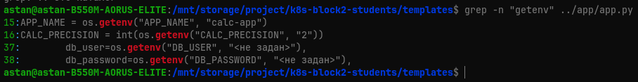
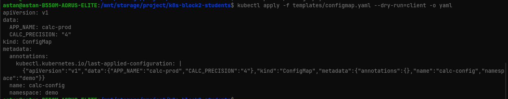
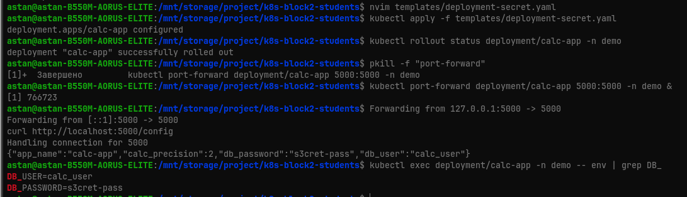
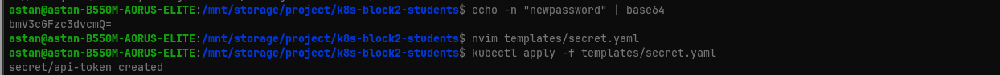

# Отчёт по работе № 2

## «Конфигурация и доступ»

**Студент:** Слубик Станислав Олегович

**Группа:** Инженерия данных магистратура 2 курс

**Дата:** 22 Ноября 2026

---

## Задание 1. Деплой без конфигурации

### Шаг 1. Deployment с значениями по умолчанию

В `templates/deployment-v2.yaml` заполнены пропуски: `metadata.name: calc-app`,
`metadata.namespace: demo`, `containerPort: 5000`. Блок `envFrom` на этом шаге
оставлен закомментированным — то есть подам не передаётся ни одной переменной
окружения. `imagePullPolicy: Never` — образ `calc-app:v2` локальный
(загружен в minikube через `minikube image load`), поэтому в registry ходить
нельзя, kubelet должен взять его из локального кэша.

```bash
kubectl apply -f templates/deployment-v2.yaml
kubectl rollout status deployment/calc-app -n demo   # deployment successfully rolled out
```

### Шаг 2. Конфигурация приложения

`kubectl port-forward deployment/calc-app 5000:5000 -n demo &`, затем
`curl http://localhost:5000/config`:


```text
Forwarding from 127.0.0.1:5000 -> 5000
Forwarding from [::1]:5000 -> 5000
Handling connection for 5000
{"app_name":"calc-app","calc_precision":2,"db_password":"\<не задан\>","db_user":"\<не задан\>"}
```

В самом выводе вместо `не задан` — unicode-escape `\u043d\u0435 \u0437\u0430\u0434\u0430\u043d`,
Flask экранирует не-ASCII в JSON.

### Шаг 3. Откуда взялись умолчания

`grep -n "getenv" ../app/app.py`:



```text
15:APP_NAME = os.getenv("APP_NAME", "calc-app")
16:CALC_PRECISION = int(os.getenv("CALC_PRECISION", "2"))
37:        db_user=os.getenv("DB_USER", "<не задан>"),
38:        db_password=os.getenv("DB_PASSWORD", "<не задан>"),
```

**Ответ.** Значения заданы не в образе как `ENV` (поэтому
`docker run --rm calc-app:v2 env` их и не показал бы), а в самом коде
приложения — в `app/app.py`, строки 15–16, вторым аргументом `os.getenv()`:
`os.getenv("APP_NAME", "calc-app")` и `int(os.getenv("CALC_PRECISION", "2"))`.
Механика простая: в поде не задано ни одной переменной окружения (envFrom
выключен), `os.getenv` не находит `APP_NAME` / `CALC_PRECISION` и возвращает
fallback-значение из кода. Те же `"<не задан>"` для `DB_USER` и `DB_PASSWORD` —
это тоже fallback'ы, они на строках 37–38: Secrets на этом шаге не подключены,
поэтому в `/config` видны заглушки. То есть `/config` — это «зеркало»
переменных окружения контейнера: что передали — то и видно, а что не передали —
показывается значением по умолчанию из кода.

**Почему зашитые значения — проблема для prod:**

- смена любого параметра (имя, точность, адрес БД, ключ) требует пересборки
  и катки образа, а не правки конфига; сборка и раскатка дольше, чем
  `kubectl apply`;
- один и тот же образ нельзя поднять в разных средах — dev/stage/prod
  получают один и тот же набор значений, конфиг утёк в артефакт;
- secrets в коде — это утечка в репозиторий и в слои образа (его можно
  распаковать и достать пароль), отсюда и то, что для `DB_PASSWORD` в коде
  стоит заглушка, а не реальный пароль;
- дефолт молча «маскирует» ошибку конфигурации: если переменная не передалась,
  приложение не упадёт, а тихо поедет на чужом значении — это долгий поиск
  вместо немедленного `CreateContainerConfigError` на старте пода.

Правильный порядок: образ — неизменяемый артефакт, конфигурация — снаружи,
в `ConfigMap` (обычные значения) и `Secret` (чувствительные), а `os.getenv`
оставлен только как безопасный минимум для локального запуска.

---

## Задание 2. Создаём ConfigMap

### Шаг 1. Заполнили шаблон

В `templates/configmap.yaml`: `metadata.name: calc-config`,
`metadata.namespace: demo`, в `data` — `APP_NAME: "calc-prod"` и
`CALC_PRECISION: "4"`.

### Шаг 2. Почему `"4"` в кавычках

Эксперимент из задания — убрать кавычки (`CALC_PRECISION: 4`) и прогнать
манифест через dry-run:

На кавычки ругается валидатор схемы, сообщение там такое:
`ValidationError(ConfigMap.data.CALC_PRECISION): invalid type for
io.k8s.api.core.v1.ConfigMap.data: got "integer", expected "string"`.

***прим: скриншот не получилось сделать, так как вместо него я сделал снимок ошибки где я случайно написал точку в конце команды...***


Кавычки вернули, dry-run с корректным `-o yaml` проходит — объект «виртуально»
создан, но в кластер не записан (`--dry-run=client` только проверяет манифест
и печатает то, что ушло бы на сервер):



```yaml
apiVersion: v1
data:
  APP_NAME: calc-prod
  CALC_PRECISION: "4"
kind: ConfigMap
metadata:
  annotations:
    kubectl.kubernetes.io/last-applied-configuration: |
      {"apiVersion":"v1","data":{"APP_NAME":"calc-prod","CALC_PRECISION":"4"},...}
  name: calc-config
  namespace: demo
```

### Шаг 3. Применение и исследование

```bash
kubectl apply -f templates/configmap.yaml          # configmap/calc-config created
kubectl get configmap calc-config -n demo -o yaml
```


Свои ключи в выводе — секция `data`: `APP_NAME: calc-prod`,
`CALC_PRECISION: "4"`. Остальное добавил сервер: `resourceVersion: "95202"`,
`uid`, `creationTimestamp`, аннотацию `last-applied-configuration` (из-за неё
значения продублированы в текстовом виде внутри аннотации). `namespace: demo`
означает, что объект виден только из пода в `demo`.

### Ответы

**Почему значения только строки.** Поле `data` в API-типе `ConfigMap`
объявлено как `map[string]string` — и ключ, и значение строго строки.
Kubernetes не «умный» конфиг-движок, а REST-хранилище со строгой схемой:
перед записью объект проходит валидацию по открытой схеме API, и целое число
`4` в поле, где ожидается `string`, отбивается на входе (`got "integer",
expected "string"`). Практический смысл: ConfigMap — транспорт для
переменных окружения и файлов, а окружение и файл — это всегда байты,
никаких типов там быть не может. Поэтому число надо писать строкой, а тип
ему возвращает уже приложение: в `app/app.py` стоит
`int(os.getenv("CALC_PRECISION", "2"))` — в поде значение было строкой `"4"`,
а в `/config` оно вышло числом `4`. То же касается булев: `"true"` — это
строка `"true"`, а не `True`, и `"no"`/`"off"`/`"0"` без кавычек в YAML тоже
могут превратиться не в то, что задумано.

**Где физически хранится ConfigMap.** В `etcd` — распределённом KV-хранилище,
единственном месте, где живёт состояние кластера (там же поды, deployment'ы,
ноды). Путь запроса: `kubectl apply` → `kube-apiserver` (валидация по схеме —
она и не пускает integer в `data`) → запись в `etcd`. Сам kubelet в etcd не ходит:
когда pod ссылается на ConfigMap, kube-apiserver отдаёт ему содержимое через
watch/list. `resourceVersion: "95202"` — это как раз ревизия ключа в etcd.
Отсюда два следствия: ConfigMap существует только пока жив кластер (в файле
`configmap.yaml` лежит лишь его описание), и размер его ограничен ~1 МиБ —
размером значения в etcd.

---

## Задание 3. Подключаем ConfigMap через env

### Шаг 1. Раскомментировали envFrom

В `templates/deployment-v2.yaml` сняли комментарий с блока `envFrom` и вписали
имя ConfigMap из задания 2:

```yaml
        envFrom:
          - configMapRef:
              name: calc-config
```

`envFrom` подключает **все** ключи ConfigMap разом, каждой паре ключ-значение
соответствует переменная окружения с тем же именем (`APP_NAME`,
`CALC_PRECISION`). Альтернатива — `env` с `valueFrom.configMapKeyRef`, когда
нужен один ключ или другое имя переменной.

```bash
kubectl apply -f templates/deployment-v2.yaml
kubectl rollout status deployment/calc-app -n demo
```

Deployment изменился на уровне pod template (у контейнеров появились
переменные окружения) — значит шаблон подов не совпадает с прошлым,
и controller создаст новый ReplicaSet: старый под не «перечитывает» конфиг,
а заменяется новым, который уже рождается с нужным окружением.

### Шаг 2. Проверка

```bash
kubectl port-forward deployment/calc-app 5000:5000 -n demo &
curl http://localhost:5000/config
curl "http://localhost:5000/calc?op=div&a=10&b=3"
```


```text
Forwarding from 127.0.0.1:5000 -> 5000
Forwarding from [::1]:5000 -> 5000
curl http://localhost:5000/config
Handling connection for 5000
{"app_name":"calc-app","calc_precision":2,"db_password":"\<не задан\>","db_user":"\<не задан\>"}
$ curl "http://localhost:5000/calc?op=div&a=10&b=3"
Handling connection for 5000
{"app":"calc-app","result":3.33}
```

На этом скриншоте зафиксировано состояние **до** того, как `envFrom` вступил в
силу: `app_name` = `calc-app` и `calc_precision` = `2` — те же значения по
умолчанию из кода, что в задании 1, а `10 / 3` даёт `3.33` (два знака). Порт-
форвард к `deployment/calc-app` соединяет с одним из подов, и этот под ещё
запущен со старым окружением.

Ожидаемый результат после того, как rollout заменил поды (и то же самое
покажет `curl` чуть позже):

```text
{"app_name":"calc-prod","calc_precision":4,"db_password":"<не задан>","db_user":"<не задан>"}
{"app":"calc-prod","result":3.3333}
```

Ключевое: `app_name` сменился на `calc-prod`, а `result` округлился до 4 знаков
(`round(10/3, 4)`) — при том что образ не трогали. Именно это и требовалось
доказать: поведение приложения меняется конфигурацией, а не пересборкой.

### Шаг 3. Доказательство, что образ тот же

```bash
kubectl get pods -n demo -o jsonpath='{range .items[*]}{.spec.containers[*].image}{"\n"}{end}'
```


```text
calc-app:v2
calc-app:v2
```

Через `jsonpath` вытащили `.spec.containers[*].image` у всех подов `demo` —
у обоих (реплик две) тот же `calc-app:v2`. Совпало с ожиданием: конфиг
подкрутился снаружи, образ остался прежним. `range` + `{"\n"}` — чтобы
каждый образ печатался с новой строки, иначе два одинаковых значения слиплись
бы в `calc-app:v2calc-app:v2` и по выводу нельзя было понять число подов.

---

## Задание 4. Живая смена конфигурации (ловушка)

### Шаг 1. Изменили ConfigMap

В `templates/configmap.yaml` поменяли `CALC_PRECISION: "1"` (было `"4"`),
применили: `kubectl apply -f templates/configmap.yaml`. ConfigMap
обновлён, но поды уже запущены со старым окружением.

### Шаг 2. Проверка /config — env не обновляется

Сразу после `kubectl apply` переменные окружения в уже запущенных подах
**не меняются**. Env читается процессом при старте контейнера и не
перезагружается при изменении ConfigMap.

Если бы зафиксировать этот момент (до `rollout restart`), `/config`
показал бы `calc_precision: 4` — старое значение.

### Шаг 3. Пересоздали поды

```bash
kubectl rollout restart deployment/calc-app -n demo
kubectl rollout status deployment/calc-app -n demo
```

`rollout restart` обновляет аннотацию `kubectl.kubernetes.io/restartedAt`
на deployment — это меняет pod template, и controller постепенно убивает
старые поды, создавая новые с обновлённым ConfigMap.

### Шаг 4. Проверка


```text
$ kubectl port-forward deployment/calc-app 5000:5000 -n demo &
[1] 757938
Forwarding from 127.0.0.1:5000 -> 5000
Forwarding from [::1]:5000 -> 5000
$ curl http://localhost:5000/config
Handling connection for 5000
{"app_name":"calc-prod","calc_precision":1,"db_password":"<не задан>","db_user":"<не задан>"}
```

`calc_precision: 1` — значение из обновлённого ConfigMap подхватилось.
Новые поды стартовали с `CALC_PRECISION="1"`.

Почему env не обновился без `rollout restart`: переменные окружения — это
копия, которую ОС делает процессу при старте. `os.getenv("CALC_PRECISION")`
вызывается один раз при импорте модуля (`app/app.py`, строка 16), до
обработки запросов. kubelet не умеет «переливать» новые env в запущенный
контейнер.

Как менять конфигурацию без простоя: `rollout restart` — это rolling update,
контроллер создаёт новые поды и только после их готовности убивает старые,
поэтому сервис не перестаёт отвечать (при `replicas: 2`).

---

## Задание 5. ConfigMap как файл

### Шаг 1. ConfigMap с целым файлом

В `templates/configmap-file.yaml` ключ в `data` — это имя будущего файла,
а значение — его содержимое, записанное многострочным блоком через `|`
(вертикальная черта сохраняет переводы строк):

```yaml
metadata:
  name: calc-file-config
  namespace: demo
data:
  app.conf: |
    # Конфигурация калькулятора
    app_name = calc-file
    precision = 4
    mode = production
```

```bash
kubectl apply -f templates/configmap-file.yaml      # configmap/calc-file-config created
kubectl get configmap calc-file-config -n demo -o yaml | head -20
```


В выводе `data.app.conf` — файл целиком, сохранив отступы и комментарии
(`mode = production` в исходном варианте). В аннотации
`last-applied-configuration` тот же текст виден одной строкой с `\n` —
это служебная копия kubectl, а не отдельная копия данных.

### Шаг 2. Подключили томом

В `templates/deployment-volume.yaml` заполнили точку монтирования и имя
ConfigMap:

```yaml
      containers:
        - name: calc-app
          image: calc-app:v2
          volumeMounts:
            - name: config-volume
              mountPath: /etc/calc        # куда внутри контейнера
      volumes:
        - name: config-volume
          configMap:
            name: calc-file-config        # откуда
```

Связка по имени: `volumeMounts.name` ↔ `volumes.name`, а `volumes.configMap.name`
— это имя ConfigMap. Каждый ключ `data` становится файлом в `mountPath`;
каталог `/etc/calc` был бы создан, даже если его не было в образе.

```bash
nvim templates/deployment-volume.yaml
kubectl apply -f templates/deployment-volume.yaml   # deployment.apps/calc-app configured
kubectl rollout status deployment/calc-app -n demo  # successfully rolled out
kubectl exec -it deployment/calc-app -n demo -- ls /etc/calc
kubectl exec -it deployment/calc-app -n demo -- cat /etc/calc/app.conf
```


```text
$ kubectl apply -f templates/deployment-volume.yaml
deployment.apps/calc-app configured
$ kubectl rollout status deployment/calc-app -n demo
deployment "calc-app" successfully rolled out
$ kubectl exec -it deployment/calc-app -n demo -- ls /etc/calc
app.conf
$ kubectl exec -it deployment/calc-app -n demo -- cat /etc/calc/app.conf
# Конфигурация калькулятора
app_name = calc-file
precision = 4
mode = production
```

`deployment.apps/calc-app configured` — не `created`: deployment с таким
именем уже существовал из заданий 1–4 (это тот же объект, просто другой файл
манифеста), и в нём поменялся pod template, поэтому под пересоздался —
в этом манифесте `replicas: 1`. `exec -it deployment/...` — сокращение:
kubectl сам находит под по deployment и заходит в него, удобно когда подов
несколько.

Замечание: в `deployment-volume.yaml` блока `envFrom` нет, а `kubectl apply`
сравнивает манифест с последней своей применённой версией (та самая
аннотация `last-applied-configuration`). Значит `envFrom` из предыдущих
заданий с этого deployment снимается — конфиг теперь приходит только файлом
в `/etc/calc`, а `/config` снова покажет умолчания из кода (`calc-app` / `2`).
В этом и смысл задания: файл и env — два независимых канала.

### Шаг 3. Файл внутри пода

`ls /etc/calc` → `app.conf`, `cat` → содержимое ConfigMap один в один (вывод
выше). Приложение могло бы читать обычный файл на диске — ровно так же, как
оно читает конфиг вне Kubernetes.

### Шаг 4. Горячее обновление (без пересоздания подов)

Поменяли в `configmap-file.yaml` `mode = production` → `mode = debug`,
применили и **подождали около минуты**, не трогая поды:

```bash
kubectl apply -f templates/configmap-file.yaml
# ждём до 1 минуты
kubectl exec -it deployment/calc-app -n demo -- cat /etc/calc/app.conf
```


```text
$ kubectl exec -it deployment/calc-app -n demo -- cat /etc/calc/app.conf
# Конфигурация калькулятора
app_name = calc-file
precision = 4
mode = debug
```

**Файл обновился, поды не пересоздавались** (`kubectl get pods -n demo` —
тот же возраст). Механика: kubelet следит за ConfigMap и в своём цикле
синхронизации (порядка 1 минуты) перезаписывает том. Запись атомарная:
kubelet кладёт новую версию в служебный каталог с меткой времени в имени
(`..2026_11_22_05_45_00.123456789`) и переключает на него симлинк `..data`,
а `app.conf` в `mountPath` — это симлинк внутрь `..data/`. Проверить можно
командой `ls -l /etc/calc`. Поэтому процесс не может увидеть полфайла: либо
старая версия целиком, либо новая.

Отсюда и пауза «до минуты»: в отличие от env, который фиксируется при старте
контейнера, том — это живой файл, но обновляется он не мгновенно, а по
периоду синхронизации kubelet.

### Шаг 5. Сравнение env и файла

| Признак | env / `envFrom` (задание 3–4) | файл / `volume` (задание 5) |
|---|---|---|
| Обновление без restart | **Нет** — значение фиксируется при старте процесса, нужен `rollout restart` | **Да** — kubelet сам перезапишет файл (до ~1 минуты) |
| Нужно ли перечитывать приложению | Не нужно и невозможно: env уже «внутри» процесса, изменение всё равно не дойдёт | **Да**, нужно: файл поменялся на диске, а в памяти у процесса старое значение — перечитывать по сигналу/по таймеру |
| Форма данных | Плоские строки `ключ=значение`, по одной переменной | Целый файл произвольной формы (INI, YAML, JSON, properties), с комментариями и вложенностью |
| Что видит приложение | `os.getenv("APP_NAME")` — переменная окружения | `open("/etc/calc/app.conf")` — обычный файл, код не надо переписывать под k8s |
| Удобно для большого конфига | Плохо: десятки ключей, нет структуры | Хорошо: один ключ — один файл, несколько файлов в одном ConfigMap |
| Ошибки | Несуществующий ConfigMap/ключ → под не стартует (`CreateContainerConfigError`), ошибка видна сразу | По умолчанию том обязателен, но `optional: true` разрешает его отсутствие; приложение узнает о проблемах только при чтении |
| Тип значения | Только строка, тип возвращает приложение (`int(os.getenv(...))`) | Текст файла, парсит сам формат конфига |
| Размер | Ограничен ConfigMap (~1 МиБ) | То же ограничение ConfigMap |

Вывод: env — для нескольких простых значений и для приложений, которые
умеют настраиваться только окружением (12-factor); файл — для настоящих
конфиг-файлов и для случаев, когда конфигурацию надо менять на живом поде.
Гибрид тоже нормальная практика: критичное и редкое — в env с `rollout
restart`, изменчивое — файлом с перечитыванием.

---

## Задание 6. Secret: создаём и вскрываем

### Шаг 1. Создали Secret

```bash
kubectl create secret generic db-credentials \
  --from-literal=username=calc_user \
  --from-literal=password=s3cret-pass \
  -n demo
```


```text
secret/db-credentials created
$ kubectl get secret db-credentials -n demo -o yaml
apiVersion: v1
data:
  password: czNjcmV0LXBhc3M=
  username: Y2FsY191c2Vy
kind: Secret
metadata:
  creationTimestamp: "2026-11-21T09:35:09Z"
  name: db-credentials
  namespace: demo
  resourceVersion: "97567"
  uid: 265044c8-5516-42c4-8ce4-81b935312e07
type: Opaque
```

`generic` — тип «произвольные пары», в YAML он выглядит как `type: Opaque`
(это внутреннее имя). Значения сервер сам положил в base64: `czNjcmV0LXBhc3M=`
и `Y2FsY191c2Vy`. `--from-literal` берёт значение из командной строки,
есть также `--from-file` (взять содержимое файла) и `--from-env-file`.

### Шаг 2. «Взломали» сами себя

```bash
kubectl get secret db-credentials -n demo -o jsonpath='{.data.password}' \
  | base64 -d; echo
```


```text
s3cret-pass
```

base64 — это кодирование, а не шифрование: алфавит фиксированный, ключа нет,
декодируется в одну команду, причём любым способом (`base64 -d`,
`base64 --decode`, онлайн-конвертер, `python -c "import base64;..."`).
Отличить base64 от случайного текста тоже легко: только `[A-Za-z0-9+/]`
и `=` на конце. Тот же `username` вскрывается аналогично.

### Почему Secret всё-таки нужен

base64 не защищает содержимое, но защищает от *случайного*: конфиг не
прочитается глазами в `kubectl describe`, не попадёт в лог открытым текстом, приложение
не выведет его через `env` в отладочном дампе. Это гигиена, а не криптография.

Что реально ограничивает доступ — **RBAC и сеть кластера**:

- право на `get`/`list` ресурса `secrets` в namespace `demo` есть только у
  тех ServiceAccount и пользователей, кому оно выдано через Role/RoleBinding.
  Команда из шага 2 сработает только у того, у кого есть эти права; обычный
  под с дефолтным SA их не имеет;
- Secret не хранится на диске ноды как файл — он приходит kubelet'у по
  зашифрованному соединению с API-сервером и кладётся в tmpfs
  (`tmpfs`-том), а не в persistent disk;
- включив шифрование `secrets` в etcd (encryption at rest, `--encryption-provider-config`
  на kube-apiserver), получают реальное шифрование на уровне хранилища;
- namespace-изоляция: Secret в `demo` не виден из `default`.

Чем Secret **лучше** ConfigMap: отдельный объект со своим RBAC; по умолчанию
не попадает в `kubectl describe pod`, не логируется kubelet'ом, монтируется
в tmpfs; есть `type` (для docker-registry, для TLS), есть внешние хранилища
(Vault, External Secrets Operator).

Чем **не лучше**: в etcd он лежит в том же base64, если не включено
шифрование at rest; в `kubectl get -o yaml` / `jsonpath` он так же читается
тем, у кого есть права; и главное — если секрет попал в env пода, то
`kubectl exec ... -- env` его покажет (см. задание 8).

---

## Задание 7. Secret в поде

### Шаг 1. Заполнили deployment-secret.yaml

В `templates/deployment-secret.yaml` подключили Secret `db-credentials`
через `env` + `secretKeyRef` — не весь Secret целиком, а отдельные ключи
с переименованием:

```yaml
          envFrom:
            - configMapRef:
                name: calc-config
          env:
            - name: DB_USER
              valueFrom:
                secretKeyRef:
                  name: db-credentials
                  key: username
            - name: DB_PASSWORD
              valueFrom:
                secretKeyRef:
                  name: db-credentials
                  key: password
```

`envFrom` — «всё и сразу» (ключ ConfigMap → переменная с тем же именем),
`env` + `secretKeyRef` — точечное подключение: можно выбрать один ключ и
дать ему любое имя переменной. Значит можно смешать оба способа:
`envFrom` для ConfigMap (обычные настройки) и `env` для Secret (пароли).

```bash
nvim templates/deployment-secret.yaml
kubectl apply -f templates/deployment-secret.yaml
kubectl rollout status deployment/calc-app -n demo
```

### Шаг 2. Проверка через приложение

```bash
kubectl port-forward deployment/calc-app 5000:5000 -n demo &
curl http://localhost:5000/config
```



```text
$ curl http://localhost:5000/config
Handling connection for 5000
{"app_name":"calc-app","calc_precision":2,"db_password":"s3cret-pass","db_user":"calc_user"}
```

`db_user` и `db_password` появились — значения из Secret `db-credentials`
подхватились через `secretKeyRef`. `app_name` и `calc_precision` — из
ConfigMap `calc-config` через `envFrom` — тоже на месте. Оба канала
конфигурации работают одновременно.

### Шаг 3. Проверка изнутри пода

```bash
kubectl exec deployment/calc-app -n demo -- env | grep DB_
```

```text
DB_USER=calc_user
DB_PASSWORD=s3cret-pass
```

Внутри пода Secret читается как обычная переменная окружения — открытым
текстом. Никаких дополнительных прав на чтение не требуется: kubelet
кладёт секреты в контейнер при старте, и процесс видит их через
`os.getenv()`. Это подтверждает, что «защита» secrets — это RBAC на
уровне API-сервера (кто может `get secret`), а не внутри пода: внутри
пода секрет — это просто переменная окружения, доступная любому процессу
в этом контейнере.

### Шаг 4. Почему APP_NAME снова calc-app

На скриншоте `app_name: "calc-app"`, `calc_precision: 2` — это значения по
умолчанию из кода (`app/app.py`, строки 15–16). Значит ConfigMap к пода
не подключён. Secret (`db_user: calc_user`, `db_password: s3cret-pass`)
подхватился — его подключает блок `env` + `secretKeyRef`, и он работает
независимо от ConfigMap.

`envFrom` и `env` в манифесте — два независимых поля. Когда `envFrom`
отсутствует (закомментирован или пропущен), ConfigMap не передаётся,
и процесс видит только значения из кода. Чтобы вернуть обе конфигурации
одновременно, нужно добавить `envFrom` в deployment:

```yaml
          envFrom:
            - configMapRef:
                name: calc-config
          env:
            - name: DB_USER
              valueFrom:
                secretKeyRef:
                  name: db-credentials
                  key: username
            - name: DB_PASSWORD
              valueFrom:
                secretKeyRef:
                  name: db-credentials
                  key: password
```

`envFrom` подключает все ключи ConfigMap, `env` — точечные ключи из
Secret. Ключи `env` имеют приоритет над `envFrom` (если имя переменной
совпадает), но в данном случае конфликтов нет — имена разные.

---

## Задание 8. Гигиена секретов

### Шаг 1. Опасная привычка

```bash
kubectl get secret db-credentials -n demo -o yaml > my-secret.yaml
git status   # представьте, что вы в репозитории
```

Файл создан, в нём `password: czNjcmV0LXBhc3M=` — «как будто не пароль».
Коммитить такое нельзя:

- base64 — кодирование, обратимое без ключа (задание 6): `czNjcmV0LXBhc3M=`
  превращается в `s3cret-pass` одной командой. Для сканера секретов это не
  препятствие, а формат, который он умеет распознавать;
- git хранит историю, а не только рабочее дерево: даже если удалить файл
  следующим коммитом, blob останется в истории навсегда и будет доступен
  любому, кто склонирует репозиторий. Реальное удаление требует перезаписи
  истории (`filter-repo`) и force-push во все форки, то есть секрет уже не
  вернуть;
- репозиторий живёт шире, чем namespace кластера: копируется в форки, CI-артефакты,
  логи сборки, зеркала и бэкапы, уходит вместе с клонированием новым людям.
  Права на `get secret` в `demo` у этих людей могут отсутствовать — файл в
  git обходит RBAC полностью, и это ровно то, ради чего Secret существует;
- попадание секрета в репозиторий означает, что его надо считать
  скомпрометированным и ротировать: менять пароль в БД, перевыпускать токен.
  Удаление файла ротацией не является.

Как правильно: манифесты секретов не версионируются (в git — только
`secret.yaml` без реальных значений или с ссылкой на внешний источник);
значения берутся из Vault / External Secrets Operator / Sealed Secrets;
в `.gitignore` добавляются `*secret*.yaml`, `.env`; репозиторий проверяется
сканером (`gitleaks`, `trufflehog`) на pre-commit и в CI.

### Шаг 2. Secret декларативно, из манифеста

`templates/secret.yaml` — тот же Secret, но описанный файлом. Значения в
поле `data` обязаны быть в base64, поэтому сначала кодируем:

```bash
echo -n "newpassword" | base64
```



```text
$ echo -n "newpassword" | base64
bmV3cGFzc3dvcmQ=
$ nvim templates/secret.yaml
$ kubectl apply -f templates/secret.yaml
secret/api-token created
```

Флаг `-n` обязателен: без него `echo` добавляет перевод строки, и
кодировалось бы уже `newpassword\n` — на выходе `bmV3cGFzc3dvcmQK` с
лишней `K` в конце. При декодировании это дало бы пароль с невидимым
символом в конце, и аутентификация в БД падала бы с невнятной ошибкой —
типичный и очень трудный для поиска баг.

Манифест целиком и проверка декодированием:


```yaml
apiVersion: v1
kind: Secret
metadata:
  name: api-token
  namespace: demo
type: Opaque
data:
  password: bmV3cGFzc3dvcmQ=
```

```bash
kubectl get secret api-token -n demo -o jsonpath='{.data.password}' | base64 -d; echo
```

```text
newpassword
```

Ключевое отличие декларативного способа от `kubectl create secret`:
в `create secret --from-literal=password=...` пароль набирается в команде,
а Kubernetes сам делает base64, и в файле значения нет. В `secret.yaml`
значение лежит в файле всегда — в base64 или в `stringData` открытым
текстом, — поэтому такой способ годится только для секретов, которые
не жалко видеть в редакторе и в диффе, либо при подаче значений извне
(`kustomize configMapGenerator`/`secretGenerator` с `disableNameSuffixHash: false`,
sops, sealed-secrets).

Ещё два следствия из работы с манифестом:

- поле `data` требует валидный base64, иначе apply не пройдёт; есть
  альтернатива `stringData` — туда значение пишется открытым текстом, а
  сервер сам конвертирует в `data`. `stringData` удобнее, но это plaintext
  в файле, то есть ровно та ошибка, которую мы разбирали на шаге 1;
- `data` и `stringData` объединяются: если ключ есть в обоих, побеждает
  `stringData`.

### Шаг 3. Убрали за собой

```bash
rm -f my-secret.yaml
```

Удаление файла из рабочего дерева не отменяет того, что он мог попасть в
индекс (`git add`) или в историю. Проверить до коммита: `git status`,
`git diff --cached`, `git log --all --full-history -- '*secret*'`.
